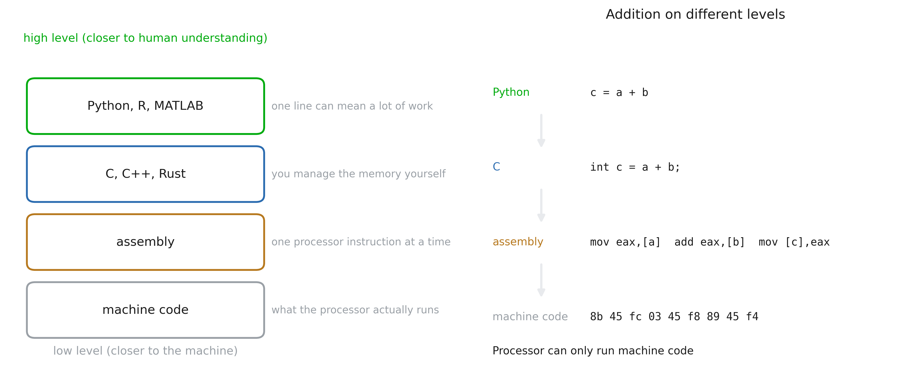
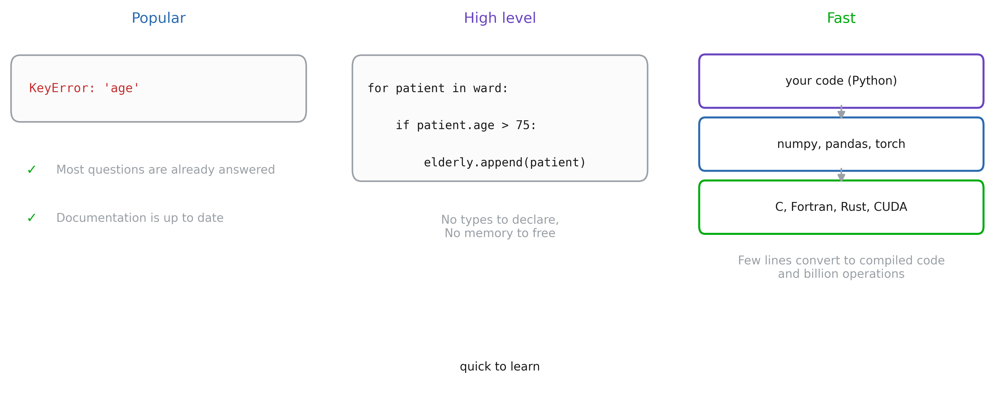
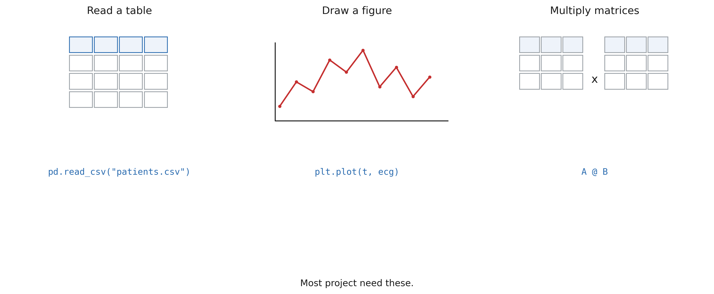

# 0. Pourquoi Python ?

## Niveau bas, niveau haut



::: notes
Une langue est un niveau de description. Le code machine est ce que le processeur exécute : des nombres.
L'assemblage est la même chose avec les noms, une instruction par ligne. C, C++ et Rust vous permettent
écrivez des expressions, mais vous décidez toujours où se trouve chaque octet. Python vous permet d'écrire le
ce que vous vouliez dire, et décide du reste pour vous.
Un niveau bas achète du contrôle et de la vitesse, et coûte des lignes de code et des bugs (chaque tampon et chaque
le pointeur est à vous pour bien faire). Un niveau élevé fait gagner du temps et coûte un certain contrôle.
Rien ici n'est « meilleur » : ils siègent à différents points d'un même métier.
:::

## Python



::: notes
Trois raisons, par ordre d'importance pour vous cette année.
1. Populaire : c’est le langage le plus utilisé dans les données et dans la recherche en santé. Pratiquement chaque
   la question que vous vous poserez a déjà été posée et répondue, et chaque bibliothèque dont vous avez besoin
   a une interface Python.
2. Haut niveau : peu de syntaxe à apprendre, donc le temps passe dans les données et non dans le
   langue. Vous serez productif en quelques semaines, pas en années.
3. Toujours rapide : les boucles lourdes ne sont pas exécutées par Python. numpy, les pandas et la torche sont minces
   Python fait surface sur C, Fortran, Rust et CUDA compilés. Vous écrivez les 20 lignes qui
   décrire le calcul et le code compilé effectue le milliard d'opérations.
La limite honnête : les boucles Python pures sur des millions de lignes sont lentes. Toute la compétence est
laisser les bibliothèques faire la boucle.
:::

# 1. Bibliothèques

## Tâches partagées dans de nombreux projets



::: notes
Lire un tableau, dessiner une figure, multiplier deux matrices : chaque projet dans la salle en a besoin,
et aucun d’entre eux n’est aussi simple qu’il y paraît. Lire un CSV signifie des séparateurs, des citations,
encodages, valeurs manquantes et dates. Dessiner une figure signifie des axes, des graduations, des étiquettes et un
exporter. Multiplier les matrices signifie bloquer le cache, les threads et les instructions vectorielles.
Parce que tout le monde en a besoin, ils sont rédigés une seule fois, par des personnes spécialisées exactement dans ce domaine.
cela, et testé par des millions d'utilisateurs. Voilà ce qu'est une bibliothèque.
:::

## Réutilisation du code


## Bibliothèques

- Bibliothèques standards
  - `tkinter` (interface graphique de base)
  - `re` (expressions régulières)
  - `json` (lecture des fichiers json)
- Bibliothèques installées :
  - `numpy` (tableaux)
  - `matplotlib`/`seaborn` (parcelles)
  - `pandas` (données)
  - `scikit-learn` (apprentissage automatique)
  - `pytorch` (réseaux de neurones)
  - `pydicom`, `nibabel` (images DICOM/NifTi)  
- Vos propres fichiers
  - ex : une architecture de réseau de neurones que vous souhaitez réutiliser

# 2. Versions et pourquoi les environnements existent

## Les bibliothèques déménagent


## Conflit entre les versions des projets 


## L'environnement virtuel est un dossier


## Créer un environnement virtuel

```bash
python3 -m venv .venv          # create it
source .venv/bin/activate      # Windows: .venv\Scripts\activate

which python3                  # my-project/.venv/bin/python3
python3 -m pip install pandas  # into .venv, not into the system

deactivate
```

## pip


## Geler un environnement

```bash
python3 -m pip freeze > requirements.txt    # pandas==2.2.3, numpy==2.1.3, ...

# on another machine, in a fresh environment:
python3 -m pip install -r requirements.txt
```

# 3. UV

## Qu'est-ce que les UV ?


::: notes
`uv` est un programme unique, écrit en Rust par Astral (les gens derrière `ruff`), d'abord
sorti en 2024. Il fait le travail de cinq outils distincts avec une commande et un
modèle mental.
Rassurement important : les commandes sont celles qu’ils ont déjà apprises. `uv pip
install pandas` does what `pip install pandas` le fait.
:::

## Vitesse


## uv en pratique
```bash
curl -LsSf https://astral.sh/uv/install.sh | sh
# no Python required

uv venv
uv pip install pandas

uv add pandas # adds library to lock file
uv sync # install dependencies in the lock file
uv run analysis.py # uses uv venv
```
