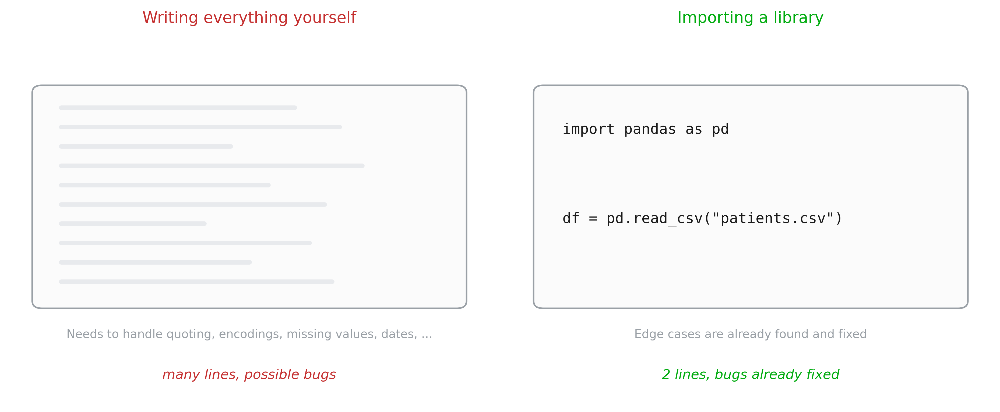
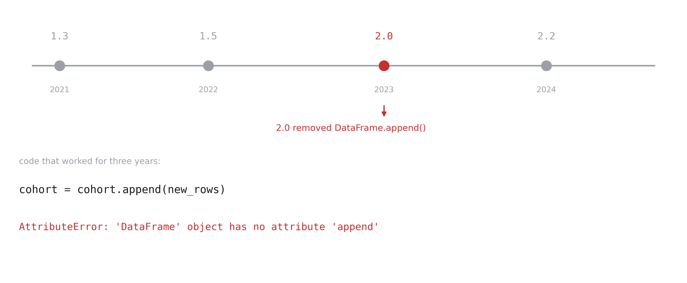
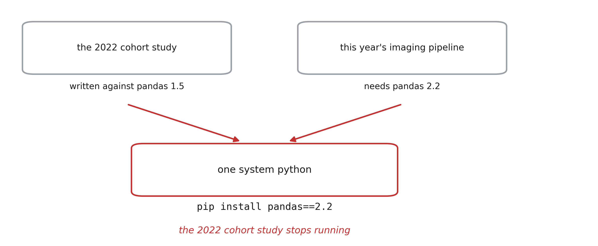
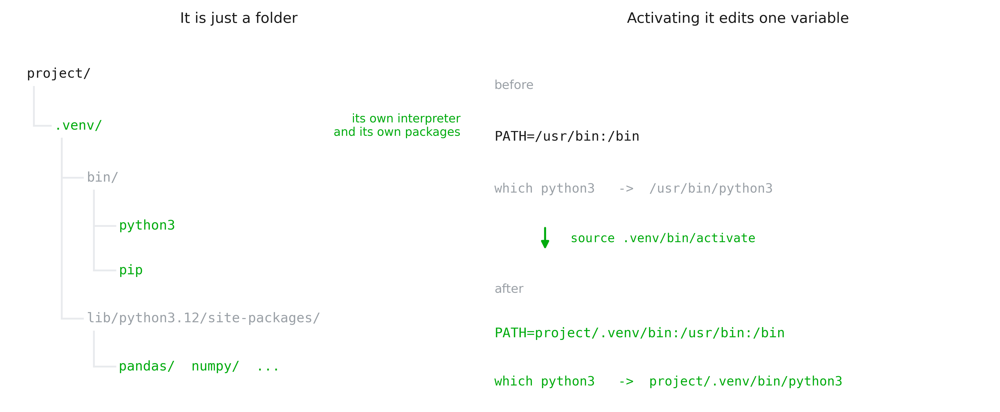
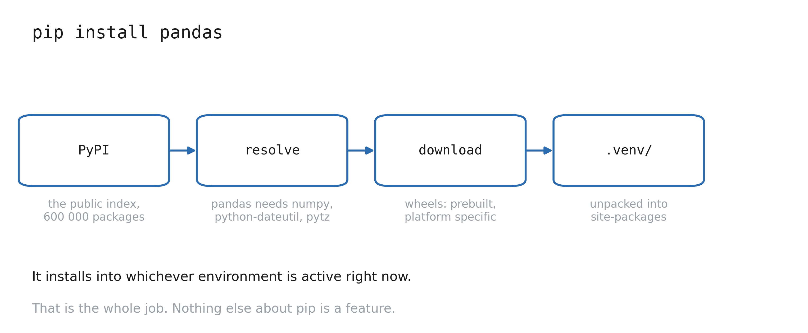
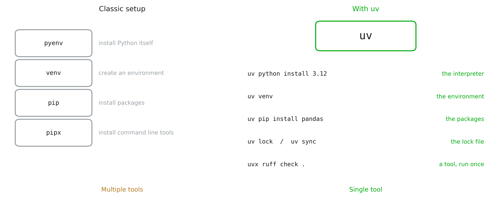
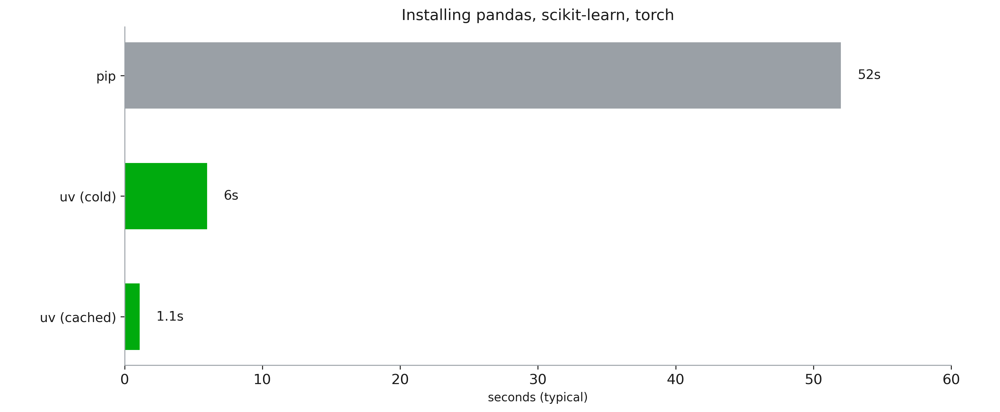

<!-- add explanation on low vs high level langages -->

<!-- say that in this course, we will use python because: it is popular, most questions are already answered; it is high level => easy to learn; it is efficient, bc most libraries are written in low level languages (hence very efficient) -->

# 1. Libraries

<!-- slide on taks that are done by everyone: read CSV, plot, matrix multiplication -->

## Reusing code




## Libraries

- Standard libraries
  - `tkinter` (basic GUI)
  - `re` (regular expressions)
  - `json` (reading json files)
- Installed libraries:
  - `numpy` (arrays)
  - `matplotlib`/`seaborn` (plots)
  - `pandas` (data)
  - `scikit-learn` (machine learning)
  - `pytorch` (neurale networks)
  - `pydicom`, `nibabel` (DICOM/NifTi images)  
- Your own files
  - e.g.: a neural network architecture you want to reuse

# 2. Versions, and why environments exist

## Libraries move



## Projects versions clash 



## Virtual environment is a folder



## Making a virtual environment

```bash
python3 -m venv .venv          # create it
source .venv/bin/activate      # Windows: .venv\Scripts\activate

which python3                  # my-project/.venv/bin/python3
python3 -m pip install pandas  # into .venv, not into the system

deactivate
```

## pip



## Freezing an environment

```bash
python3 -m pip freeze > requirements.txt    # pandas==2.2.3, numpy==2.1.3, ...

# on another machine, in a fresh environment:
python3 -m pip install -r requirements.txt
```

# 3. uv

## What is uv?



::: notes
`uv` is a single program, written in Rust by Astral (the people behind `ruff`), first
released in 2024. It does the jobs of five separate tools with one command and one
mental model.
Important reassurance: the commands are the ones they already learned. `uv pip
install pandas` does what `pip install pandas` does.
:::

## Speed



## uv in practice
```bash
curl -LsSf https://astral.sh/uv/install.sh | sh
# no Python required

uv venv
uv pip install pandas

uv add pandas # adds library to lock file
uv sync # install dependencies in the lock file
uv run analysis.py # uses uv venv
```
