# 1. Variables et valeurs

## Une variable est le nom d'une valeur

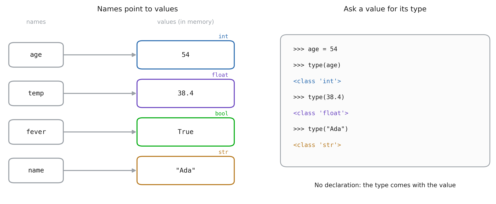

::: notes
L'image la plus utile de la session. `age = 54` ne met pas 54" dans une case
appelé âge » : il crée la valeur 54 quelque part en mémoire, et y colle l'étiquette `age`.
Le type appartient à la valeur, pas au nom. C'est pourquoi il n'y a pas de déclaration dans
Python (pas de `int age;` comme en C, vu dans la Session 0) : on ne dit jamais ce que tiendra un nom.
`type(x)` demande la valeur de quoi il s'agit. Faites-leur le taper en direct ; c'est le premier débogage
outil qu'ils rechercheront.
:::

## Chaque valeur a un type

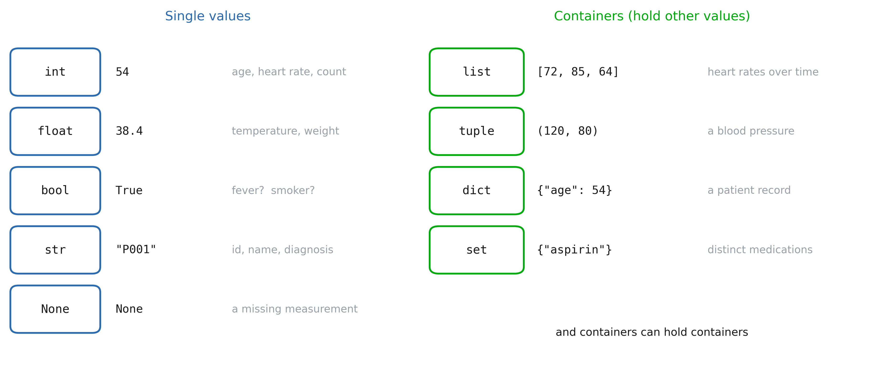

::: notes
C'est toute la cartographie de la séance, et du cahier : cinq valeurs uniques à gauche,
quatre conteneurs à droite.
Ancrez chacun à un exemple de santé, ils retiendront l'exemple avant le nom :
un âge est un `int`, une température un `float`, "a de la fièvre" un `bool`, un identifiant de patient un `str`,
une mesure que personne n'a prise est `None`. Une Series de fréquences cardiaques est un `list`, une tension artérielle
un `tuple`, un dossier patient un `dict`, les différents médicaments présents dans un service un `set`.
:::

## Les noms peuvent changer de type

```python
x = 42          # an int
x = "42"        # now a str
x + 1           # TypeError
int(x) + 1      # 43
```

::: notes
Saisie dynamique : le label déplacé vers une nouvelle valeur, d'un nouveau type. Python a permis au
réaffectation, mais il refuse toujours de mélanger des types qui n'ont aucun sens ensemble.
Lisez le message d'erreur à haute voix avec eux. Les erreurs Python nomment les types impliqués, et
apprendre à lire cette ligne représente la moitié du débogage.
:::

# 2. Valeurs uniques

## Numéros : `int` et `float`

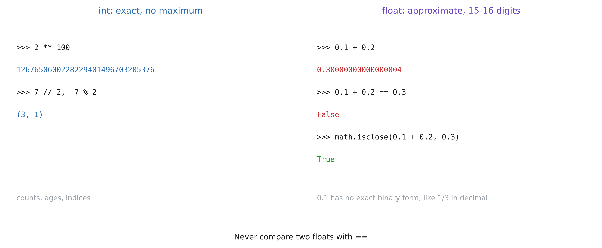

::: notes
`int` est exact et n'a pas de maximum : `2 ** 100` fonctionne simplement, Python fait croître l'entier comme
nécessaire. `float` est une approximation sur 64 bits : environ 16 chiffres significatifs et un maximum
proche de 1.8e308 (`2.0 ** 1024` débordements).
`0.1 + 0.2 != 0.3` surprend tout le monde une fois. Ce n'est pas un bug Python : 0.1 n'a pas de valeur exacte
forme binaire, exactement comme 1/3 n'a pas de forme décimale exacte. Chaque langue fait cela.
La règle à retenir : comparer les floats avec `math.isclose`, jamais avec `==`. Une valeur de laboratoire
le filtre écrit avec `==` sur les floats supprimera silencieusement les lignes.
:::

## Opérateurs arithmétiques

| Expressions | Résultat | Tapez |
|---|---|---|
| `7 + 2`, `7 - 2`, `7 * 2` | `9`, `5`, `14` | `int` |
| `7 / 2` | `3.5` | `float`, toujours |
| `7 // 2` | `3` | `int` (division d'étage) |
| `7 % 2` | `1` | `int` (reste) |
| `7 ** 2` | `49` | `int` (puissance) |
| `round(3.14159, 2)` | `3.14` | `float` |

::: notes
Celui à souligner : `/` renvoie toujours un flottant, même pour `6 / 2` (donne `3.0`).
`//` et `%` vont ensemble : "combien de groupes complets et ce qui reste". Exemple :
`minutes // 60` et `minutes % 60` transforment une durée de séjour en heures et minutes.
`int(3.9)` vaut 3 : `int` est tronqué, il n'est pas arrondi. Utilisez `round` lorsque vous voulez dire rond.
:::

## Booléens et comparaisons

```python
temp = 38.4

36.5 <= temp <= 37.5   # False
fever = temp >= 38     # True
fever and not False    # True

type(fever)            # bool
True + True            # 2
```

::: notes
Les comparaisons produisent des booléens, et les booléens sont ce que `if` et les filtres consomment.
La comparaison chaînée est une subtilité Python qui se lit comme des mathématiques ; la plupart des langues ont besoin
`temp >= 36.5 and temp <= 37.5`.
`True + True == 2` est une curiosité maintenant, mais il sera utile plus tard : `sum(fevers)` compte le
les patients ayant de la fièvre, et `mean` d'une colonne booléenne est une proportion.
Notez `=` (attribuer) contre `==` (comparer) : la faute de frappe la plus courante de la semaine.
:::

## Chaque valeur est vraie ou fausse

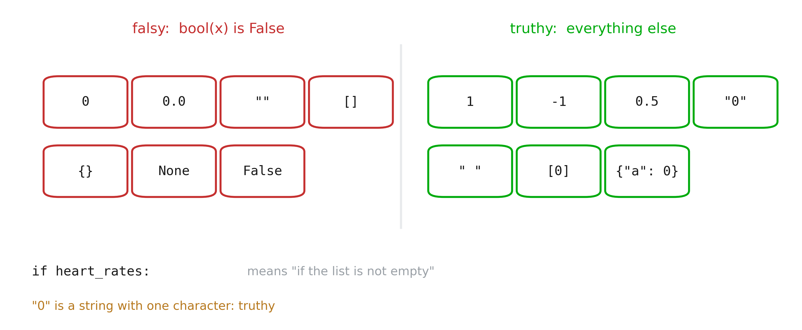

::: notes
N'importe quelle valeur peut être placée dans un `if`. Zéro et vide sont faux, tout le reste est vrai.
Cela donne un code court et idiomatique (`if heart_rates:` au lieu de `if len(heart_rates) > 0:`),
et un piège classique : la chaîne `"0"` lue depuis un CSV est véridique, car c'est un
chaîne non vide. Convertissez avant de tester.
:::

## Chaînes : `str`

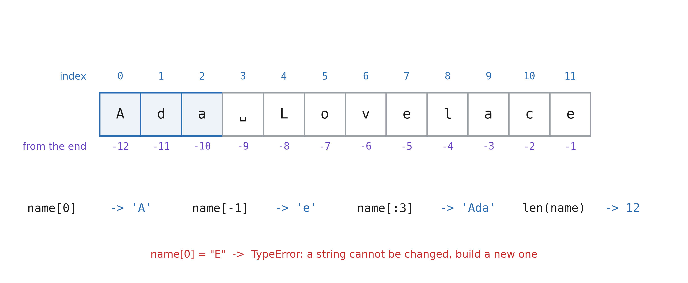

::: notes
Une chaîne est une séquence de caractères et les séquences partagent une grammaire d'indexation qu'elles
sera réutilisé pour les listes, les tuples, les tableaux numpy et les pandas : les indices commencent à 0, les indices négatifs
comptez à partir de la fin, et une tranche `[start:stop]` exclut `stop`.
`name[:3]` est « les trois premiers », `name[-1]` « le dernier » : dites-les sous forme de phrases.
Les chaînes sont immuables : vous ne modifiez jamais une chaîne, vous en construisez une nouvelle. C'est pourquoi chaque
La méthode string renvoie un résultat au lieu de modifier la chaîne en place.
:::

## Travailler avec du texte

```python
raw = "  Diabetes Type 2 \n"
raw.strip()       # "Diabetes Type 2"
raw.strip().lower().replace(" ", "_")
                  # "diabetes_type_2"
"Ada Lovelace".split()
                  # ["Ada", "Lovelace"]
bmi = 22.857142
f"BMI: {bmi:.2f}" # "BMI: 22.86"
```

::: notes
Cette diapositive est un nettoyage de données en miniature. Le texte libre d'un système hospitalier est livré avec
espaces parasites, casse mixte et sauts de ligne ; `strip`, `lower` et `replace` le normalisent
de sorte que « diabète de type 2 » et « diabète de type 2 » comptent comme le même diagnostic.
Chaîne de méthodes car chacune renvoie une nouvelle chaîne.
Les f-strings sont le moyen de créer du texte à partir de valeurs : `{bmi:.2f}` signifie "deux décimales".
Ils remplacent `"BMI: " + str(bmi)`, qui est plus long et ne formate pas.
:::

## Conversions et `None`

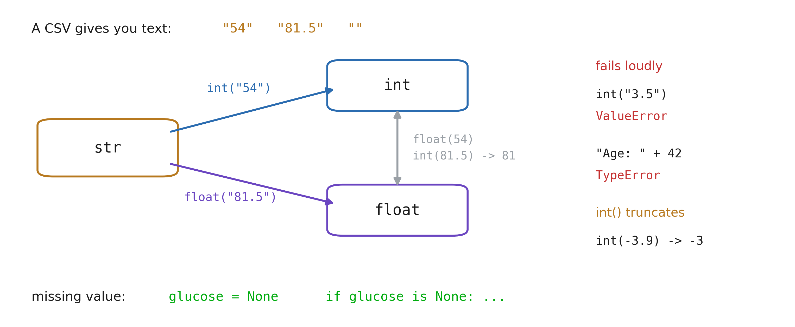

::: notes
Tout ce qui est lu dans un fichier ou saisi par un utilisateur arrive sous forme de texte. `"54"` n'est pas 54 jusqu'à ce que
vous le convertissez et `"54" + 1` échoue.
Les conversions échouent bruyamment lorsque le texte ne correspond pas à ce que vous attendiez : `int("3.5")` est un
`ValueError`, pas un 3 silencieux. C'est une fonctionnalité : une mauvaise ligne arrête le script au lieu de
corrompre le résultat.
`None` est la « aucune valeur » de Python : le glucose qui n'a pas été mesuré. Ce n'est pas 0 (un glucose
de 0 serait un patient mort). Testez-le avec `is None`, pas `== None`.
:::

# 3. Conteneurs

## Quatre conteneurs

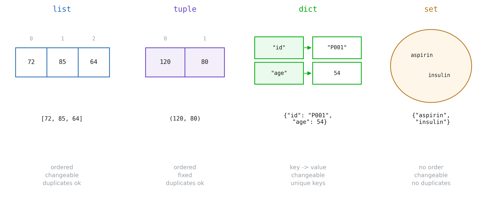

::: notes
Trois questions décident quel conteneur utiliser.
(1) Puis-je trouver des éléments par position ou par nom ? Position : liste ou tuple. Nom : dict.
(2) Est-ce que ça va changer ? Une liste s'allonge à mesure que les mesures arrivent ; un tuple est un enregistrement fixe,
  comme (systolique, diastolique).
(3) Les doublons sont-ils importants ? Un ensemble conserve chaque valeur une fois, ce qui correspond exactement à « la valeur distincte ».
  médicaments".
Syntaxe littérale : crochets pour les listes, parenthèses pour les tuples, accolades pour les dictionnaires et
ensembles (les accolades avec `key: value` paires forment un dict). Attention : `{}` est un dict vide ; un
l'ensemble vide est `set()`.
:::

## Listes : `list`

```python
heart_rates = [72, 85, 64, 90, 78]
heart_rates[0]       # 72
heart_rates[1:4]     # [85, 64, 90]

heart_rates.append(101)   # at the end
heart_rates[1] = 80       # by position
heart_rates.remove(64)    # by value

sum(heart_rates) / len(heart_rates)
[hr for hr in heart_rates if hr > 80]
```

::: notes
Même indexation et découpage que les chaînes : ils le savent déjà. La différence est qu'une liste
peut changer sur place.
`min`, `max`, `sum` et `len` fonctionnent sur n'importe quelle liste de nombres.
La dernière ligne est une compréhension de liste : "l'heure, pour chaque heure en heart_rates, si hr > 80".
Lisez-le dans cet ordre. C'est la manière Python de filtrer et de transformer, et c'est la forme
de ce que feront les pandas sur une colonne entière.
`sorted(x)` renvoie une nouvelle liste triée ; `x.sort()` trie sur place et renvoie `None`.
L'attribution du résultat de `.sort()` est un bug classique.
:::

## Deux noms, une liste

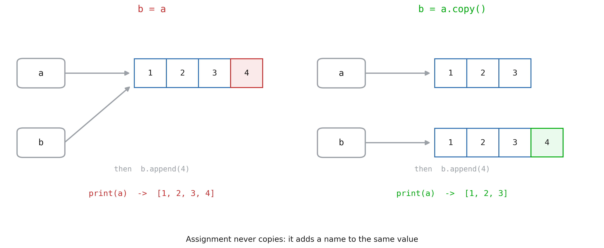

::: notes
Retour à la première image : `b = a` colle une deuxième étiquette sur la même liste. Ce n'est pas le cas
copie. L'ajout via `b` est visible via `a`, car il n'y a qu'une seule liste.
Cela est important dès qu'ils transmettent une liste à une fonction ou prennent une "copie" d'une table à
nettoyez-le. `.copy()` (ou `list(a)`, ou `a[:]`) constitue une liste indépendante.
Les chaînes, les nombres et les tuples sont immuables, leur partage est donc inoffensif : rien ne peut
changez-les en place. Le piège n'existe que pour les valeurs mutables : listes, dicts, ensembles.
:::

## Tuples : `tuple`

```python
blood_pressure = (120, 80)
systolic, diastolic = blood_pressure

blood_pressure[0] = 130   # TypeError

x, y = 1, 2
x, y = y, x               # swap
```

::: notes
Un tuple est un groupe fixe de valeurs qui vont ensemble : une tension artérielle, une (ligne, col)
coordonnée, une plage (min, max). Le point est fixe : personne ne peut changer la moitié d'un sang
pression par accident.
Au déballage, chaque pièce a un nom, et il est partout : `for key, value in d.items()`,
fonctions renvoyant plusieurs valeurs, l'idiome swap.
Étant immuable, un tuple peut être une clé de dict ; une liste ne le peut pas.
:::

## Dictionnaires : `dict`

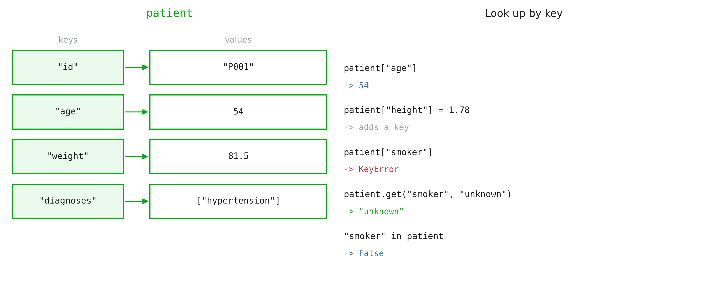

::: notes
Un dict mappe les clés aux valeurs : un enregistrement où chaque champ a un nom. `patient["age"]` est
plus clair que `patient[1]` et reste correct lorsqu'un champ est ajouté.
Les clés manquantes génèrent un `KeyError`. Deux façons de gérer : testez d'abord avec `in`, ou utilisez `.get` avec
un défaut. Préférez `.get` lorsqu'un champ manquant est normal (le statut de fumeur l'est souvent).
La recherche par clé est instantanée quelle que soit la taille du dict ; c'est pourquoi les dictées sont
aussi utilisé pour compter les choses : `counts[d] = counts.get(d, 0) + 1`.
Boucle avec `for key, value in patient.items():`.
:::

## Ensembles : `set`

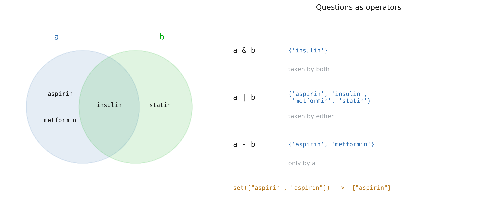

::: notes
Un ensemble conserve chaque valeur une fois et n'a aucun ordre. La conversion d'une liste en un ensemble est la plus rapide
manière de dédupliquer : `len(set(medications))` est le nombre de médicaments distincts.
Les opérateurs répondent directement aux questions cliniques : quels médicaments deux patients partagent-ils ?
(`&`, contrôles d'interactions), quels médicaments apparaissent (`|`), lesquels sont spécifiques à un (`-`).
`x in some_set` est instantané, comme pour les touches de dictée.
:::

## Résumé

| Tapez | Exemple | Modifiable | Commandé | Accès |
|---|---|---|---|---|
| `int`, `float` | `54`, `38.4` | non | | |
| `bool` | `True` | non | | |
| `str` | `"P001"` | non | oui | `s[0]` |
| `None` | `None` | non | | |
| `list` | `[72, 85]` | oui | oui | `l[0]` |
| `tuple` | `(120, 80)` | non | oui | `t[0]` |
| `dict` | `{"age": 54}` | oui | par insertion | `d["age"]` |
| `set` | `{"aspirin"}` | oui | non | `x in s` |

# 4. L'assembler

## Une salle est une liste de dictées

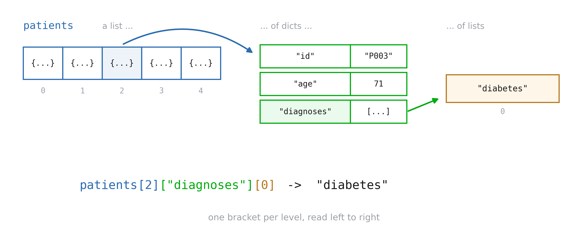

::: notes
Les données réelles sont imbriquées : une liste de patients, chacun un dict, certains champs eux-mêmes sont des listes.
C'est exactement la forme d'une exportation JSON, et de ce qu'un DataFrame pandas aplatit plus tard.
Lisez le chemin d'accès une parenthèse à la fois, en indiquant le type à chaque étape : `patients` est un
list, `[2]` donne un dict, `["diagnoses"]` donne une liste, `[0]` donne une str.
Lorsqu'un accès échoue, imprimez le `type` de la valeur intermédiaire : c'est presque toujours
"Je pensais que c'était un dicté mais c'est une liste".
:::

# 5. Tableaux NumPy

## Les listes sont lentes pour les chiffres

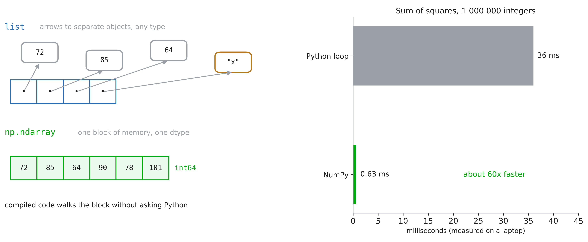

::: notes
Une liste d'un million de fréquences cardiaques correspond à un million d'objets Python distincts, chacun avec son propre
tapez, dispersés dans la mémoire; la liste ne contient que des flèches. Chaque `+` dans une boucle demande
Python "de quel type s'agit-il ?" encore.
Un tableau NumPy est un bloc contigu de nombres, tous du même type (le dtype). Le
la boucle est ensuite exécutée par du code C compilé, qui ne demande jamais : c'est le panneau "Rapide" de
Séance 0, rendue concrète.
Le prix : un tableau ne contient qu’un seul type et a une taille fixe. Pour les chiffres, c'est le
prix que vous voulez toujours payer. Mesurez-le vous-même dans le cahier avec `%timeit`.
:::

## Le `ndarray` : forme et type

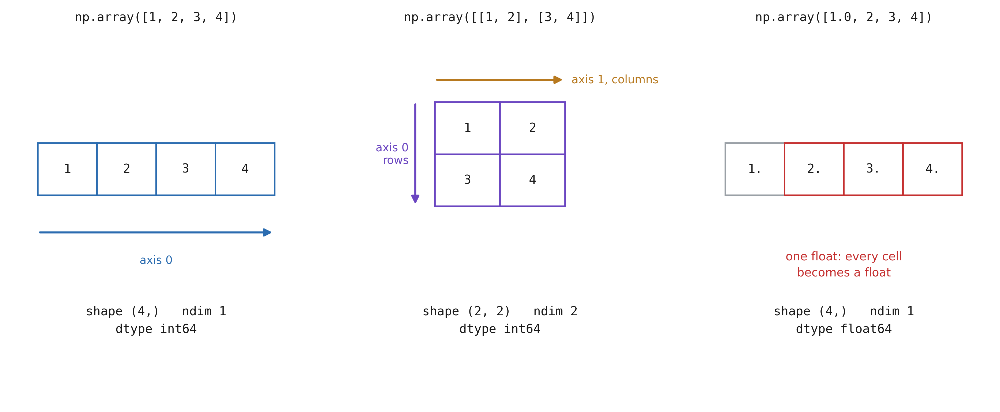

::: notes
Deux attributs décrivent chaque tableau, et ils sont la première chose à imprimer lorsque quelque chose
ça va mal. `.shape` est un tuple, la taille le long de chaque axe ; `.ndim` est sa longueur. `.dtype`
est le type unique de chaque cellule.
L'axe 0 représente les lignes (descendant), l'axe 1 les colonnes (traversant). Une table de 200
les patients par 3 mesures ont la forme `(200, 3)`.
Un flottant dans la liste et chaque cellule devient un flottant : le tableau sélectionne un type qui correspond
chaque valeur. Une chaîne dans la liste créerait un tableau de chaînes et l'arithmétique s'arrête
fonctionne, un symptôme classique d’une colonne CSV sale.
:::

## Types de données NumPy

| type | octets | détient | utilisation typique |
|---|---|---|---|
| `bool` | 1 | `True` / `False` | masques |
| `uint8` | 1 | 0 à 255 | pixels de l'image |
| `int16` | 2 | -32 768 au 32 767 | Tomodensitogrammes (unités Hounsfield) |
| `int64` | 8 | environ ±9,2e18 | comptes, identifiants (l'entier par défaut) |
| `float16` | 2 | ~3 chiffres, jusqu'à 65 504 | apprentissage profond |
| `float32` | 4 | ~7 chiffres | images, apprentissage profond, GPU |
| `float64` | 8 | ~16 chiffres | statistiques (le flottant par défaut) |

::: notes
Python en a un `int` et un `float`. NumPy a une famille de chacun, avec une taille fixe en
octets, car chaque cellule d'un tableau doit avoir la même taille pour que le bloc de mémoire soit
travail.
Le nombre dans le nom est le nombre de bits : `int16` est 16 bits, 2 octets. `u` signifie
non signé (pas de valeurs négatives).
Vous choisissez rarement : `np.array` choisit `int64` ou `float64`. Mais les fichiers que vous lisez choisissent
vous : un DICOM CT est généralement `int16`, un PNG `uint8`, un NIfTI souvent `float32` et un profond
modèle d'apprentissage `float32` ou moins. Imprimez toujours `.dtype` après le chargement des données.
:::

## À l'intérieur d'un float

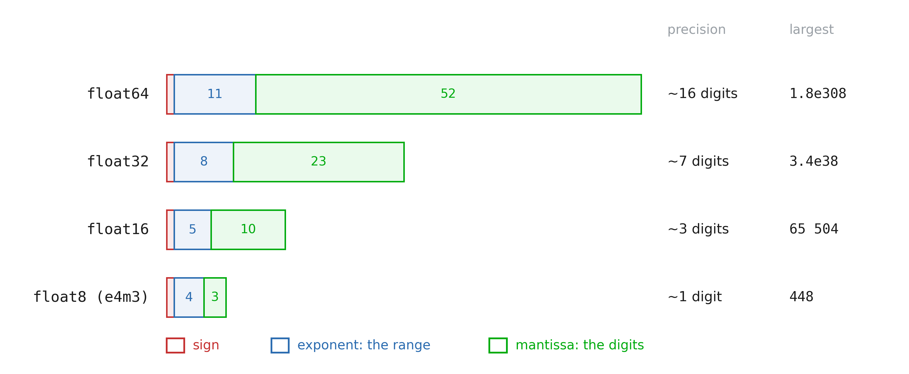

::: notes
Un flottant est une notation scientifique en binaire : un signe, un exposant (là où va le point : le
plage) et une mantisse (les chiffres significatifs : la précision).
Réduire de moitié la taille coûte aux deux. `float32` conserve 7 chiffres, ce qui est suffisant pour toute mesure effectuée dans un
hôpital. `float16` conserve 3 chiffres et ne peut pas dépasser 65 504. `float8` conserve environ un
chiffre; il existe pour le deep learning sur les GPU récents (deux variantes : e4m3 pour la précision,
e5m2 pour la gamme).
NumPy lui-même s'arrête à `float16` : `float8` vient du package `ml_dtypes` ou de
`torch.float8_e4m3fn`.
:::

## Les mêmes valeurs, quatre précisions

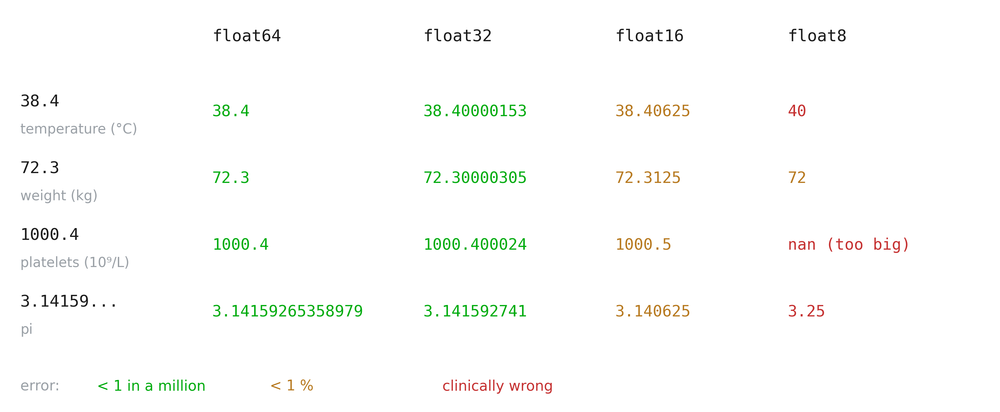

::: notes
Chaque nombre sur cette diapositive a été calculé par numpy, et non saisi à la main.
`float64` et `float32` s'accordent bien au-delà de ce que mesure un thermomètre. `float16` démarre
pour afficher : 38,40625 au lieu de 38,4, inoffensif pour une température, mais l'erreur croît avec la
valeur (1000,4 devient 1000,5 : l'écart entre deux voisins float16 proches de 1000 est de 0,5).
`float8` transforme une fièvre de 38,4 °C en 40 °C et une numération plaquettaire de 1 000 en « pas un
numéro". Il s'agit d'un format pour les poids des réseaux neuronaux, qui tolèrent le bruit, pas pour
données cliniques.
:::

## Plus petit est plus léger et plus rapide

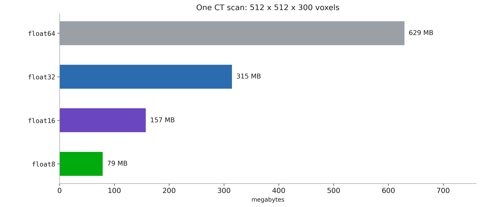

::: notes
La mémoire correspond aux octets par valeur multipliés par le nombre de valeurs. Un volume CT équivaut à 79 millions de voxels :
629 Mo en `float64`, 315 Mo en `float32`. Un lot de scans pour la formation ne tient pas sur un
GPU en `float64`.
Moins d'octets signifie également plus rapide : plus de valeurs par transfert de mémoire et les GPU ont des
matériel pour l'arithmétique 16 et 8 bits. C'est pourquoi le deep learning s'entraîne en `float32` ou
"précision mixte" (`float16`/`bfloat16` pour le gros, `float32` là où cela compte), et fonctionne
grands modèles en 8 bits ou moins.
La règle pour ce cours : `float64` pour les statistiques et les tableaux, `float32` pour les images et
des réseaux de neurones, plus petits seulement lorsqu'une bibliothèque le fait pour vous.
:::

## Choisir et convertir

```python
x = np.arange(4, dtype=np.float32)
x.dtype, x.nbytes        # float32, 16
x.astype(np.float16)     # convert: a copy

np.array([250], dtype=np.uint8) + 10
                         # [4], not 260
np.float16(70000)        # inf: overflow

h = np.full(10000, 0.1, dtype=np.float16)
h.cumsum()[-1]           # 256.0, not 1000
```

::: notes
`dtype=` à la création, `.astype()` pour convertir (il renvoie un nouveau tableau), `.nbytes` pour le
mémoire.
Trois échecs silencieux, dont aucun ne génère d'erreur :
(1) nombres entiers enroulés : 250 + 10 dans `uint8` est 4. Typique lors du réglage de la luminosité
  d'une image; convertissez d'abord en un type plus grand.
(2) `float16` déborde jusqu'à `inf` au-dessus de 65 504.
(3) ajouter de nombreux petits nombres dans des décrochages de faible précision : à 256, le 0,1 suivant est inférieur à la moitié
  l'écart entre les voisins float16 (0,25), donc la somme cesse de croître. Accumuler dans
  `float32` ou `float64` (le `.sum()` de numpy vous protège déjà mieux qu'un running
  totale, mais pas complètement).
:::

## Création de tableaux

```python
import numpy as np

np.array([72, 85, 64])
np.arange(12).reshape(3, 4)
np.linspace(0, 1, 5)     # 5 points
np.zeros((3, 4))
np.eye(4)                # identity

rng = np.random.default_rng(0)
rng.normal(1.70, 0.09, 200)
```

::: notes
`np` est l'alias universel ; chaque tutoriel, réponse et bibliothèque l'utilise.
`arange` fonctionne comme `range` (fin exclue) ; `linspace` prend un certain nombre de points et
comprend la fin. `reshape` réorganise sans copier, tant que les tailles correspondent :
12 valeurs ne peuvent pas devenir 5 x 2.
Nombres aléatoires : utilisez toujours un générateur prédéfini, donc le même script donne le même résultat
demain et sur la machine de votre collègue. C'est la reproductibilité à la plus petite échelle.
:::

## Indexation en deux dimensions

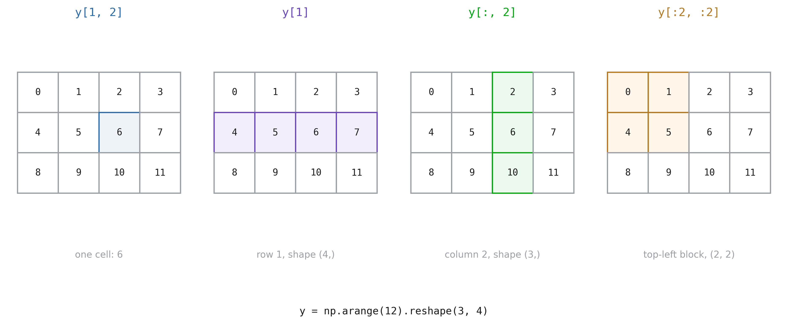

::: notes
Même grammaire que les listes et les chaînes, avec un index par axe, séparé par une virgule :
`y[row, col]`. Un `:` signifie à lui seul « tout le long de cet axe ».
`y[1]` est une ligne entière ; `y[:, 2]` une colonne entière (ce que les listes de listes ne peuvent pas faire).
Les tranches d'un tableau sont des vues, pas des copies : l'écriture dans `y[:2, :2]` change `y`. C'est
l'alias de la section précédente à nouveau ; utilisez `.copy()` lorsque vous voulez l'indépendance.
L'affectation fonctionne sur des tranches entières : `t[:, 1] = 0` définit une colonne à la fois.
:::

## Les opérations sont élémentaires

```python
x = np.arange(5)   # [0 1 2 3 4]

x ** 2             # [0 1 4 9 16]
x + 10             # [10 11 12 13 14]
np.sqrt(x)         # no loop

t * t              # element-wise
t @ t.T            # matrix product
```

::: notes
Chaque opérateur arithmétique et chaque fonction mathématique `np.` s'applique à chaque élément : ceci
c'est la vectorisation, et c'est tout le style de numpy, pandas et torch. Si vous écrivez un
`for` boucle sur les éléments d'un tableau, il y a presque toujours une seule ligne à la place.
Attention avec `*` : sur les tableaux, il multiplie élément par élément. Le produit matriciel est `@`.
Comparez avec les listes : `[1, 2] * 2` est `[1, 2, 1, 2]` et `[1, 2] + [3]` est concaténé.
Même symbole, type différent, signification différente.
:::

## Diffusion

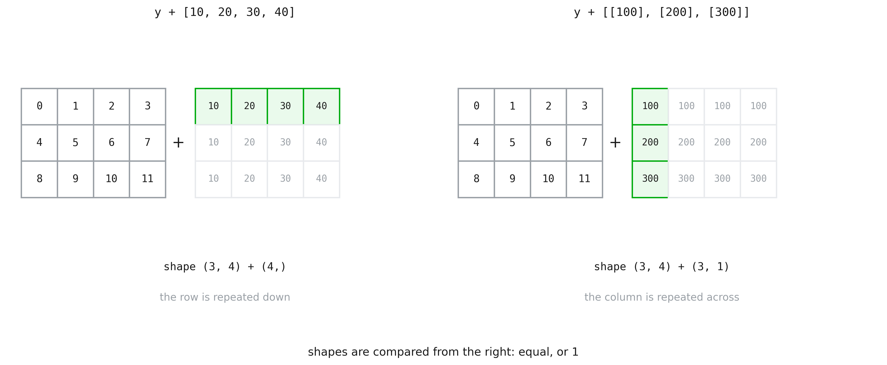

::: notes
Lorsque les formes diffèrent, numpy étend le plus petit tableau le long de l'axe manquant, comme si
il a été répété (il n’est pas réellement copié). `x + 10` diffusait déjà : un scalaire
étendu à chaque cellule.
La règle : comparer les formes en partant de la droite ; chaque paire de tailles doit être égale, ou l'une d'elles
doit être 1. `(3, 4)` et `(4,)` correspondent. `(3, 4)` et `(3,)` ne le font pas : pour ajouter une valeur par
ligne, faites-en une colonne, formez `(3, 1)`, avec `.reshape(3, 1)` ou `v[:, None]`.
Utilisation typique : soustraire la moyenne de chaque colonne d'un tableau, sur une seule ligne.
:::

## Agrégation le long d'un axe

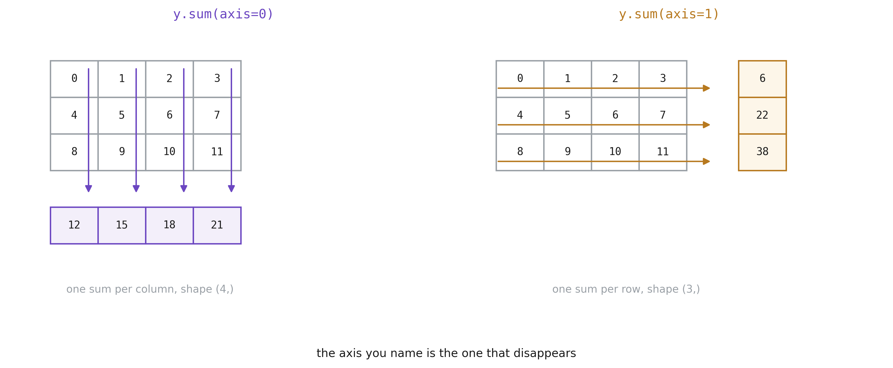

::: notes
`sum`, `mean`, `std`, `min`, `max`, `argmax` prennent tous un `axis`. Sans cela, ils réduisent
l'ensemble du tableau à un seul numéro.
La phrase qui met fin à la confusion : l’axe que vous nommez est celui qui disparaît.
`axis=0` réduit les lignes, vous obtenez donc une valeur par colonne : sur un patient x mesures
tableau, la moyenne de chaque mesure. `axis=1` donne une valeur par patient.
Vérifiez à chaque fois la forme du résultat : `(4,)` versus `(3,)` vous indique lequel vous avez fait.
La standardisation d'un tableau combine les deux slides : `(m - m.mean(axis=0)) / m.std(axis=0)`.
:::

## Masques booléens

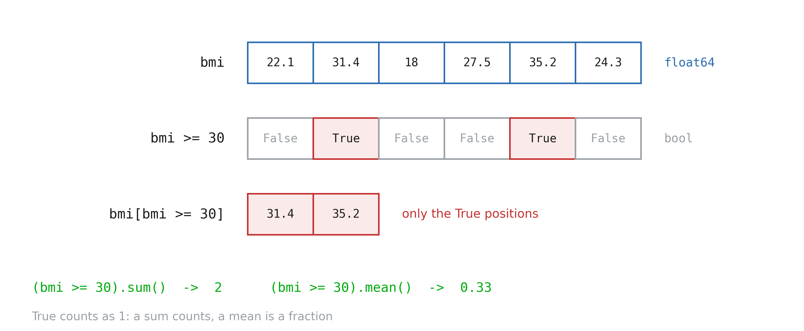

::: notes
Une comparaison sur un tableau donne un tableau de booléens de même forme : le masque. Indexation
avec un masque garde les positions où c'est True ; le résultat est toujours 1D.
C'est ainsi que vous filtrez sans boucle, et exactement comment les pandas filtrent les lignes plus tard
(`df[df["bmi"] >= 30]`).
Combinez les conditions avec `&` et `|`, pas `and` / `or`, et mettez chaque condition entre parenthèses :
`(bmi >= 18.5) & (bmi < 25)`. Oublier les parenthèses est l'erreur de la semaine.
`np.where(cond, a, b)` sélections parmi `a` où True et parmi `b` ailleurs, par ex. couper
valeurs négatives à 0.
:::

## Une cohorte en quelques lignes

```python
bmi = weight / height ** 2   # 200 at once
bmi.mean(), bmi.min(), bmi.max()

(bmi >= 30).mean()     # 0.215

cat = np.digitize(bmi, [18.5, 25, 30])
np.bincount(cat)       # [23 72 62 43]
```

::: notes
Le mini cas d'usage du notebook : 200 patients simulés (seed 42), tailles et poids
tirée des distributions normales.
Une ligne calcule 200 IMC, avec diffusion entre deux tableaux de même forme. Une moyenne
d'un masque est une fraction (21,5 % d'obèses ici). `digitize` transforme une valeur en catégorie de
les points de coupure, `bincount` compte chaque catégorie.
Comparez avec la liste des dictés de la section 4 : mêmes questions, pas de boucle, et il faudrait
le même temps sur 200 000 patients. C'est pourquoi chaque bibliothèque de données est construite sur des tableaux.
:::

## IMC de la cohorte

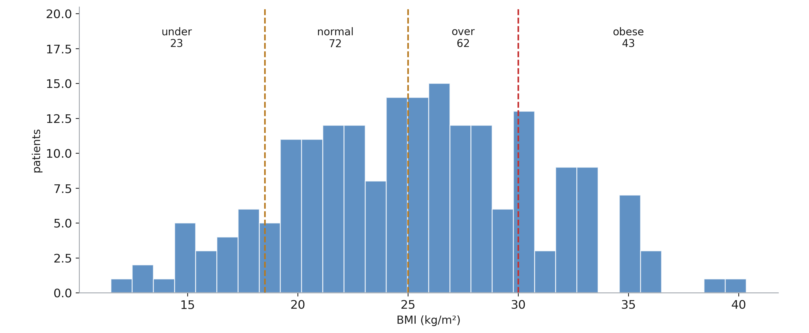
