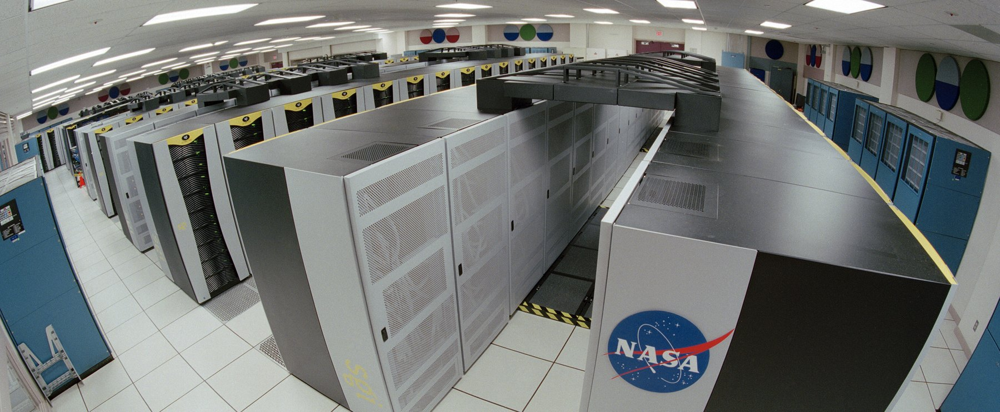

# 1. Why using a terminal?

## Most computers have no screen



::: notes
Rows of machines, and not one keyboard, mouse or monitor in the room. This is the NASA
Columbia supercomputer, but it is also every hospital server room, every cloud instance,
and every compute cluster you will send a job to.
Nobody walks in and clicks. You reach these machines over the network (`ssh`), and what
answers you is a text prompt. The graphical interface is the exception, available on your
laptop and almost nowhere else.
So the question is not whether the command line is pleasant. It is the only interface
these machines have, and that is where the data and the computing power live.
Ask the room: where do you think the imaging archive of a hospital actually sits?
:::

## Terminal, shell, program, kernel


::: notes
Four words students use as synonyms for a fortnight. Fixing this early saves a lot of
confusion later: "the terminal crashed" and "the shell is bash" and "ls is a program"
are three different statements.
Emphasise the closing line. Everything that follows (variables, loops, conditionals,
functions) is available *because* the shell is a language. The prompt is a REPL.
:::

## The anatomy of a command


::: notes
This is the grammar slide; every command in the notebook obeys it.
Two traps to name now, because both will bite in the exercises:
(1) a space separates arguments, so a filename with a space is two arguments unless
  it is quoted. Health data exports are full of `Patient Records 2024.csv`.
(2) flags are case sensitive and not universal: `-h` is "help" in some tools and
  "human readable" in others. There is no committee.
:::

# 2. Moving around, and moving data

## The filesystem is one tree


::: notes
Two ideas: there is a single root (no `C:` drive), and any file has two names
(absolute and relative) that point to the same thing.
Rule of thumb for their future scripts: absolute paths for data that lives somewhere
fixed, relative paths for anything inside the project, so the project can be moved,
shared, or run on the cluster untouched.
:::

## Five most usefull commands
```bash
pwd                     # where am I
cd data/ecg             # go there  (cd ..  goes up, cd  goes home)
ls -lh                  # what is here, with sizes
mkdir -p results/2026   # make a folder (and its parents)
cp a.csv backup/        # copy      (mv = move / rename, rm = delete)
```

::: notes
Type these live, slowly, in a scratch folder. Let them see the prompt change with
`cd`.
Give the `rm` warning its own beat. Then give them the habit that actually protects
them: run the dangerous thing as `ls` first (`ls *.tmp`), look at what matched, then
swap `ls` for `rm`. Never trust a glob you have not printed.
:::

## Text in, text out


::: notes
This is the intellectual core of the whole session, and the reason the tools are all
small. Each program does one job and speaks the same currency: lines of text. The
pipe is what makes them compose.
Build the example one stage at a time on screen, showing the intermediate output
after each `|`. Students remember the shape once they have watched it narrow.
Mention that this is exactly `pandas` chaining, ten years older and on files it never
has to load into memory.
:::

## More commands
| Command | Does |
|---|---|
| `cat` / `head` / `tail` | print a file, its first, its last lines |
| `wc -l` | count lines (rows in a CSV) |
| `grep 'ICU'` | keep the lines that match |
| `cut -d, -f2` | keep a column |
| `sort` / `uniq -c` | order, and count repeats |
| `find . -name '*.csv'` | list files matching a pattern, recursively |

::: notes
Do not try to teach these exhaustively (the notebook does that). Here just establish
that the toolbox is small, and that each one is a verb you can look up.
`sort | uniq -c` is the shell's `value_counts()`; say that out loud, it converts
anyone who already knows pandas.
:::
