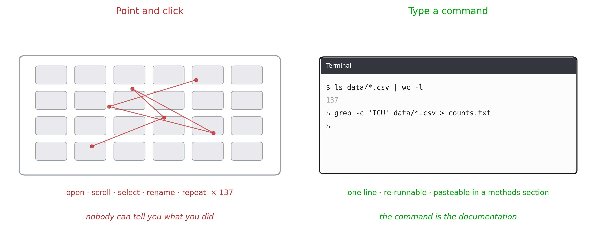
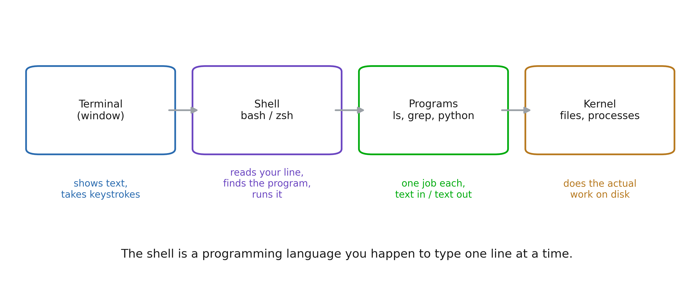
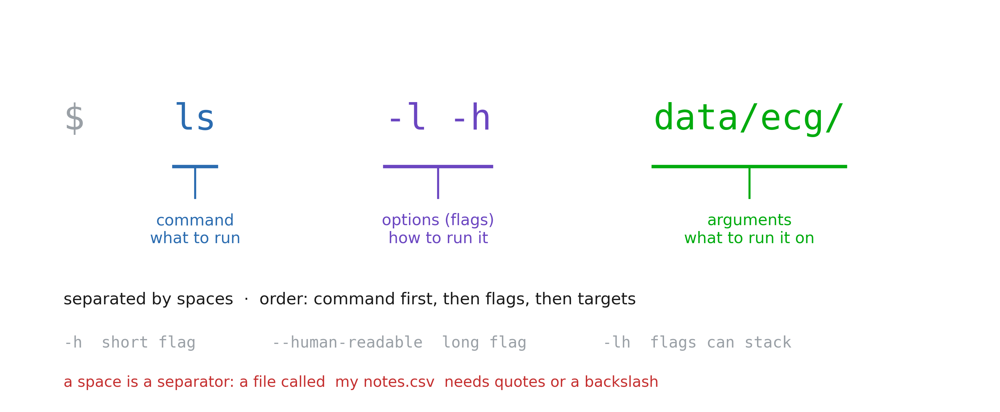
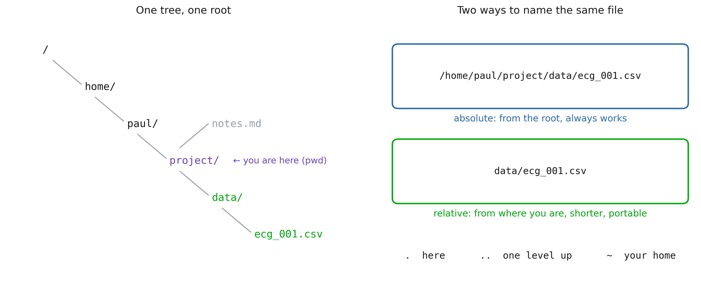
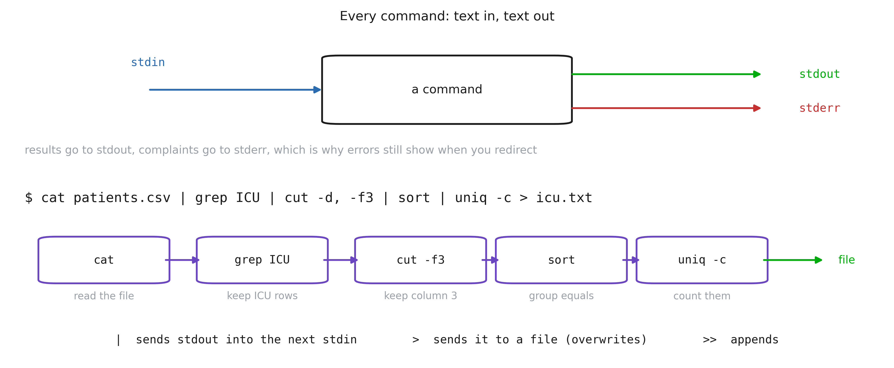
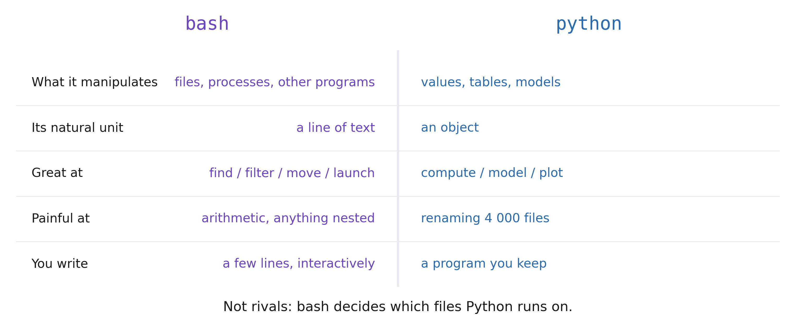
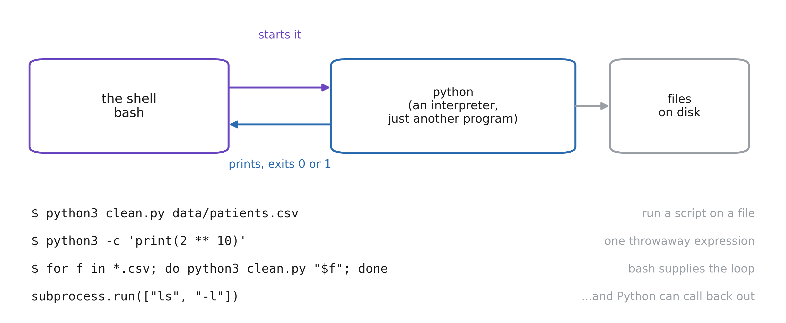
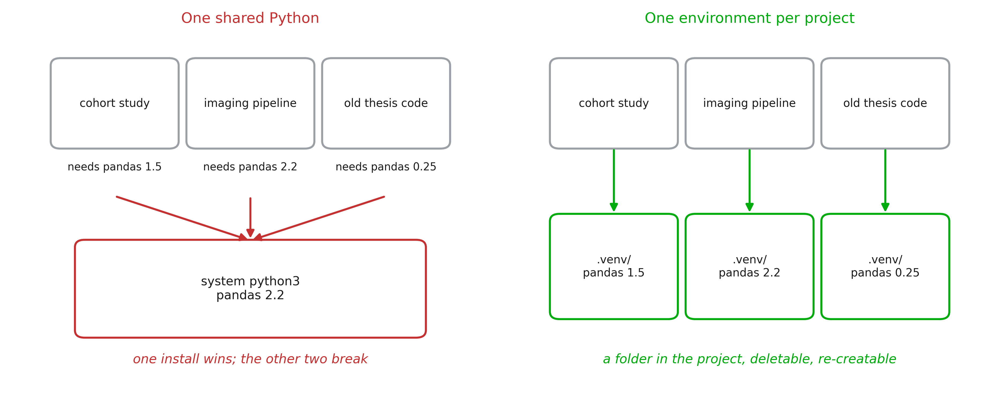

# 1. Why using a terminal?

## Some (most) tasks are faster
> You are handed 137 exported ECG files. How many mention `ICU`?



::: notes
Open on the concrete task, not on the tool. Let the room answer the question first
(someone will say "open them one by one", someone else will say "Excel").
Then show the two panels. The point is not that typing is faster (though it is). The
point is the last line: after the clicking, nobody (including you) can say what was
done. After the command, the answer and the method are the same object.
Do not defend the terminal on aesthetics. Defend it on evidence.
:::

## Where you will actually meet it
- **Servers.** Hospital data does not leave the building; you connect to a machine
  with `ssh` and there is no desktop waiting for you
- **Pipelines.** Imaging and omics tools (`dcm2niix`, `fastqc`, `samtools`) ship as
  commands, not as apps
- **Reproducibility.** There is no clicking error possible
- **Scale.** The step between 1 file and 4 000 files should cost you one line

::: notes
This is the slide that answers "why is a health data course starting with bash?".
Make it institutional, not ideological: this is simply the interface the field uses.
The `ssh` point usually lands hardest, because for regulated data, remote text access
is often the *only* access.
:::

## Terminal, shell, program, kernel


::: notes
Four words students use as synonyms for a fortnight. Fixing this early saves a lot of
confusion later: "the terminal crashed" and "the shell is bash" and "ls is a program"
are three different statements.
Emphasise the closing line. Everything that follows (variables, loops, conditionals,
functions) is available *because* the shell is a language. The prompt is a REPL.
:::

## The anatomy of a command


::: notes
This is the grammar slide; every command in the notebook obeys it.
Two traps to name now, because both will bite in the exercises:
(1) a space separates arguments, so a filename with a space is two arguments unless
  it is quoted. Health data exports are full of `Patient Records 2024.csv`.
(2) flags are case sensitive and not universal: `-h` is "help" in some tools and
  "human readable" in others. There is no committee.
:::

# 2. Moving around, and moving data

## The filesystem is one tree


::: notes
Two ideas: there is a single root (no `C:` drive), and any file has two names
(absolute and relative) that point to the same thing.
Rule of thumb for their future scripts: absolute paths for data that lives somewhere
fixed, relative paths for anything inside the project, so the project can be moved,
shared, or run on the cluster untouched.
:::

## Five most usefull commands
```bash
pwd                     # where am I
cd data/ecg             # go there  (cd ..  goes up, cd  goes home)
ls -lh                  # what is here, with sizes
mkdir -p results/2026   # make a folder (and its parents)
cp a.csv backup/        # copy      (mv = move / rename, rm = delete)
```

::: notes
Type these live, slowly, in a scratch folder. Let them see the prompt change with
`cd`.
Give the `rm` warning its own beat. Then give them the habit that actually protects
them: run the dangerous thing as `ls` first (`ls *.tmp`), look at what matched, then
swap `ls` for `rm`. Never trust a glob you have not printed.
:::

## Text in, text out


::: notes
This is the intellectual core of the whole session, and the reason the tools are all
small. Each program does one job and speaks the same currency: lines of text. The
pipe is what makes them compose.
Build the example one stage at a time on screen, showing the intermediate output
after each `|`. Students remember the shape once they have watched it narrow.
Mention that this is exactly `pandas` chaining, ten years older and on files it never
has to load into memory.
:::

## More commands
| Command | Does |
|---|---|
| `cat` / `head` / `tail` | print a file, its first, its last lines |
| `wc -l` | count lines (rows in a CSV) |
| `grep 'ICU'` | keep the lines that match |
| `cut -d, -f2` | keep a column |
| `sort` / `uniq -c` | order, and count repeats |
| `find . -name '*.csv'` | list files matching a pattern, recursively |

::: notes
Do not try to teach these exhaustively (the notebook does that). Here just establish
that the toolbox is small, and that each one is a verb you can look up.
`sort | uniq -c` is the shell's `value_counts()`; say that out loud, it converts
anyone who already knows pandas.
:::

# 3. From the shell to Python

## Two languages, one boundary


::: notes
Students arrive expecting a fight ("should I learn bash or Python?"), and the answer
is that they do different jobs. bash manipulates *files and programs*; Python
manipulates *values*. Adding two numbers in bash is awkward on purpose; renaming
4 000 files in Python is fifteen lines of `os.walk` that `mv` did in one.
The working rule: if the sentence contains "for each file", start in the shell. If it
contains "for each patient", you are already inside Python.
:::

## Python is just another program


::: notes
The demystifying slide. `python3` is a file on disk that the shell finds and starts,
exactly like `ls`, and `which python3` proves it. It reads a `.py` file, or a `-c`
string, or waits for you to type (the REPL).
Two directions to point out. The shell supplies the loop and the file list; Python
supplies the computation. And Python can call back out with `subprocess`, though if
you find yourself doing that a lot, the job was probably a shell job.
Mention the exit code: `python3 script.py && echo ok` only prints `ok` if the script
did not crash. That is how steps get chained.
:::

## What is an environment?


::: notes
The single most common source of "it works on my machine" in this field.
A virtual environment is not magic: it is a folder (`.venv/`) containing its own
`python` and its own `site-packages`. "Activating" it just puts that folder first on
`PATH`, which is why `which python3` is the diagnostic command when something is
wrong.
Say plainly: never install into the system Python. On a managed hospital workstation
you often cannot anyway, and the error will read `externally-managed-environment`.
:::

## Creating and using one
```bash
uv venv                        # create .venv/ here
source .venv/bin/activate      # put it first on PATH  (deactivate to leave)
which python3                  # .../project/.venv/bin/python3   ← the check

uv pip install pandas          # installs into .venv, not into the system
uv pip freeze > requirements.txt    # exactly what you have, for someone else
```

- One environment **per project**, inside the project, in `.gitignore`

::: notes
Type this live in an empty folder. Show `which python3` before and after activating:
that before/after is what makes the concept click.
Insist that `.venv/` is disposable and must never be committed, because it is
derived, it is large, and it is specific to one machine. What you commit is the *list* of packages.
:::

## ruff
`ruff` is a **linter** (finds mistakes) and a **formatter** (fixes layout)

```bash
uv tool install ruff     # or: uv pip install ruff  /  python3 -m pip install ruff
uvx ruff check .         # run it once, installing nothing

ruff check .             # unused imports, undefined names, dead code
ruff check --fix .       # fix what can be fixed automatically
ruff format .            # one house style, no more debates about spacing
```

::: notes
`uvx ruff check .` is the zero commitment demo (it downloads, runs, and leaves
nothing behind). Run it on the notebook folder live.
The interesting catch in a health project is usually a variable assigned and never
used: nine times out of ten that line was *meant* to update the dataframe.
`ruff format` replaces `black`; `ruff check` replaces `flake8` and most of `pylint`.
One tool, one config, in `pyproject.toml`.
:::
