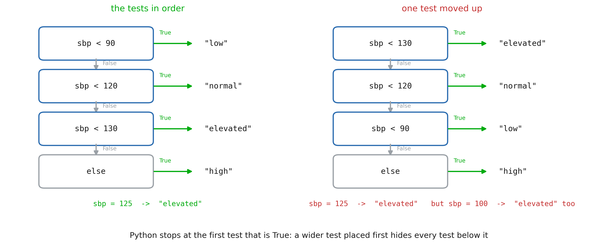
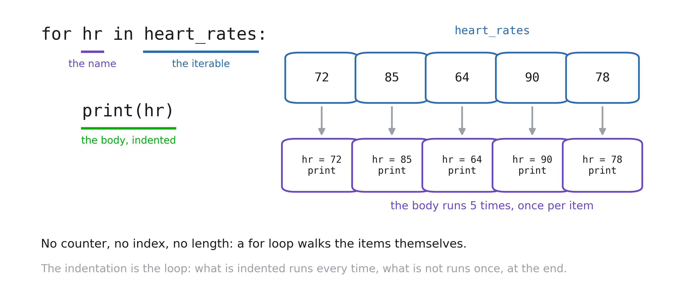
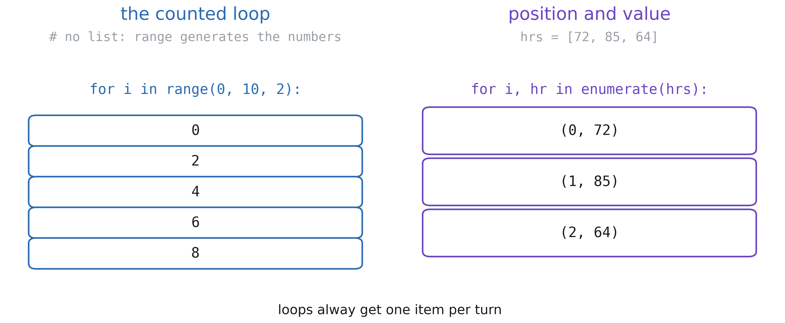
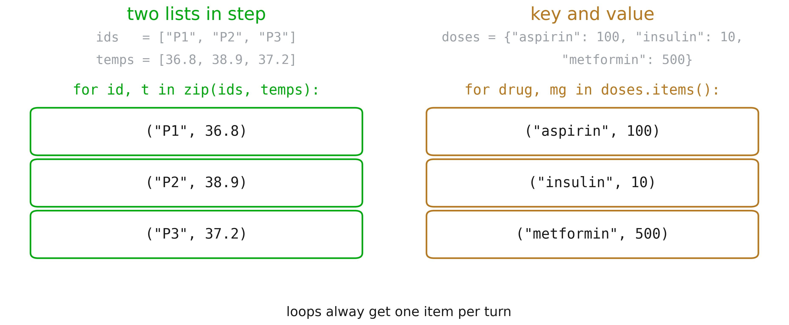
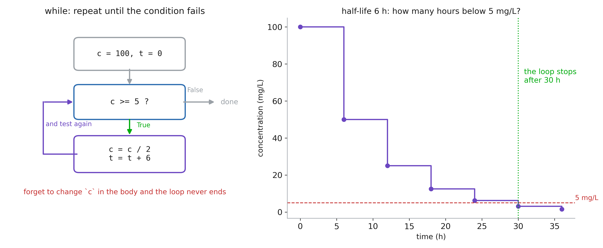
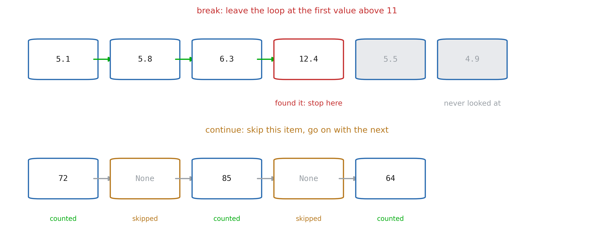
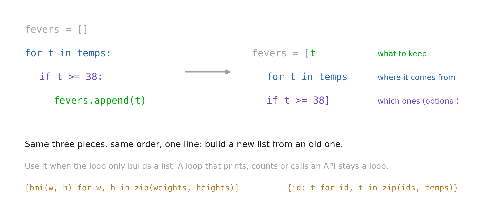
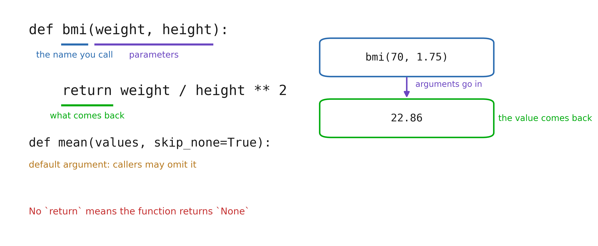
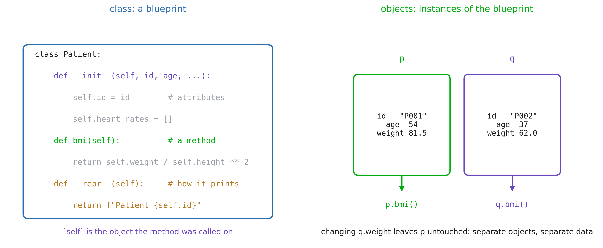
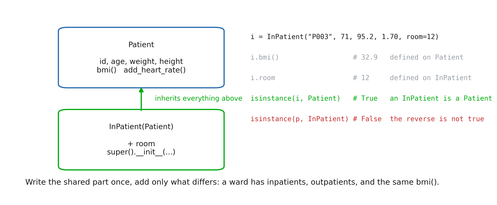

# 1. Making decisions

## `if` / `elif` / `else`

```python
temp = 38.4

if temp >= 39:
    print("high fever")
elif temp >= 38:
    print("fever")
else:
    print("no fever")
```

::: notes
Session 1 gave the values; this session gives the control: run this code only sometimes,
run that code many times, and give a name to a block of code.
Three pieces of syntax, and they are the same for every block in Python: a line ending
with a colon, then an indented block. Four spaces, always the same. The indentation is
not decoration, it is the syntax: it is what tells Python where the block stops.
`if` takes anything that is true or false, including the truthiness of Session 1
(`if heart_rates:`). The comparison `>=` produces a bool; `=` would be an assignment and
a syntax error here.
:::

## Order of tests



::: notes
With `elif`, Python tests from top to bottom and stops at the first true test: the rest
is never evaluated. So each `elif` silently means "and none of the tests above matched",
which is exactly why `sbp < 120` does not need to repeat `and sbp >= 90`.
The classic bug is on the right: a wider test placed first swallows the narrower ones,
and every patient below 130 comes out "elevated". Nothing crashes, the numbers are just
wrong, which is the dangerous kind of bug.
The rule: for thresholds, go from the narrowest to the widest, and let `else` catch what
is left.
:::

# 2. Repeating work

## `for` loop



::: notes
Read it as the English sentence it is: "for each heart rate in heart rates, do this".
The name on the left is created by the loop and takes a new value each turn; there is no
counter to initialise and no length to get right.
Point at the indented block: it runs once per item, five times here, and what is not
indented runs once, after the loop. The most common beginner bug of the session is a line
that is accidentally in or out of the body.
Coming from another language, they will want `for i in range(len(xs)): xs[i]`. Show them
the direct form once and they rarely go back.
:::

## `range` and `enumerate`



::: notes
`range(stop)`, `range(start, stop)`, `range(start, stop, step)`: the counted loop, used
when the number of turns is the point and the items are not. Note `range(5)` stops at 4,
like a slice, and that `range` builds nothing: it hands out the numbers one at a time,
which is why `range(10_000_000)` is instant and costs no memory.
`enumerate` when you need the position as well as the value: it gives a pair each turn,
unpacked into two names exactly like `a, b = 1, 2` in Session 1. Start elsewhere with
`enumerate(hrs, start=1)` when you want to count from 1 for a human reader.
If they find themselves writing `for i in range(len(hrs))` and then `hrs[i]`, `enumerate`
is what they wanted.
:::

## `zip` and `.items()`



::: notes
`zip` walks two (or more) sequences in step: ids and temperatures, heights and weights,
measured and predicted. Again a pair per turn, unpacked into two names.
One trap worth saying out loud: `zip` stops at the shortest sequence, silently. If the ids
and the temperatures do not have the same length, the extra ones are dropped without a
word, so check `len` first when the two come from different files.
`.items()` does the same for a dictionary, giving the key and the value; `.keys()` and
`.values()` exist when only one of them is needed. Iterating a dict directly gives the
keys alone, which is a common surprise.
These four helpers cover almost every loop they will write this year.
:::

## Accumulating a result

```python
total = 0
for hr in heart_rates:
    total = total + hr

mean = total / len(heart_rates)
```

::: notes
The accumulator pattern: a variable created *before* the loop, updated *inside* it, used
*after* it. Sum, count, maximum, a list being built: they are all this shape.
Create it before the loop, or the name does not exist yet; `total = 0` for a sum,
`best = values[0]` for a maximum (not 0, which breaks on negative values).
They will do this by hand in the notebook, then meet `sum`, `max` and `np.mean`, which do
the same thing faster and with less room for error. Writing it once by hand is what makes
the shortcut readable afterwards.
:::

## `while`: unknown number of iterations



::: notes
A `for` loop walks a finite collection; a `while` loop asks a question before each turn
and stops when the answer is False. Use it when the number of turns depends on the
computation itself: a half-life falling under a threshold, a solver converging, reading
until the end of a stream.
Every while loop needs three things, and forgetting the third is the classic infinite
loop: an initial state, a condition that mentions it, and a body that changes it.
The interrupt button (■) is their way out; mention it before they need it.
:::

## `break` and `continue`



::: notes
`break` leaves the loop immediately: the search is over, the remaining items are never
looked at. This is how you find the first abnormal value without scanning the rest.
`continue` abandons the current turn only and goes on to the next: the idiom for skipping
missing values, which in real exports is most of the work.
Both work in `for` and in `while`. Keep them for cases that read as "stop" or "skip":
nested in three levels of `if`, they become unreadable.
:::

## Comprehensions



::: notes
A comprehension is the same loop written as one expression: what to keep, where it comes
from, and optionally which ones. Python reads it in that order, and so should they.
It is the idiomatic way to transform a list into another list, and it shows up constantly
in real code, so they must be able to read one even if they prefer writing loops.
The limit: a comprehension builds a collection. A loop that prints, writes a file or
calls a service stays a loop. And a comprehension with two `for` and three `if` should go
back to being a loop.
:::

## Functions



::: notes
`def` creates a function; calling it runs the body with the arguments bound to the
parameters, and `return` hands a value back to the caller.
Insist on the difference between printing and returning: `print` shows a value to a human
and gives nothing back, `return` produces a value the rest of the program can use. A
function that prints its result cannot be reused.
Default arguments (`skip_none=True`) give an option without forcing every caller to think
about it. Keyword arguments at the call site (`mean(values, skip_none=False)`) are worth
the extra characters: in six months, that line still says what it does.
Scope in one sentence: names created inside the function disappear when it returns.
:::

# 3. Objects and classes

## A class is a blueprint



::: notes
They have been using objects since Session 1 without the word: a `str` has `.upper()`, a
list has `.append()`. A class is how you define your own type, for data that travels
together.
`__init__` runs at creation and stores the attributes on `self`; `self` is simply the
object the method was called on, and it is the first parameter of every method. `p.bmi()`
is just `Patient.bmi(p)`.
The names with double underscores are hooks Python calls for you: `__init__` at creation,
`__repr__` when the object is displayed, `__len__` for `len(obj)`. Define `__repr__`
early, it turns an unreadable `<object at 0x7f...>` into something they can debug with.
Two objects of the same class are independent: changing `q.weight` leaves `p` untouched.
:::

## Dictionary or class?

```python
# dict: data only
p = {"id": "P001", "age": 54}
p["age"]


# class: data + behaviour
class Patient:
    def bmi(self): ...
p.bmi()
```

::: notes
Honest answer: for a handful of fields read once from a CSV, a dict is fine, and that is
what pandas will give them anyway.
A class earns its place when behaviour belongs with the data (a BMI computed from the
patient's own fields), when the same shape is created many times, or when you want a
guarantee that every object has the same attributes, which a dict never gives you: a
typo in a key creates a new key instead of an error.
:::

## Inheritance



::: notes
`class InPatient(Patient)` means "an InPatient is a Patient, plus a room". The class in
brackets is the parent (base class, superclass); the new one is the child, or subclass.
Everything defined on `Patient` is available on an `InPatient` without being written
again: the attributes set in `__init__`, `bmi()`, `add_heart_rate()`, `__repr__`.
`super().__init__(id, age, weight, height)` calls the parent's constructor, so the shared
attributes are set in one place, by the class that owns them. Forgetting that call is the
classic mistake: the object is created, and then `i.bmi()` fails with
`AttributeError: 'InPatient' object has no attribute 'weight'`, because nobody ever set
it.
`isinstance(i, Patient)` is True, and that is the whole point: code written for patients
works unchanged on inpatients. The reverse is False; an `InPatient` is a special case of
`Patient`, not the other way round. Prefer `isinstance(x, Patient)` to
`type(x) == Patient`, which answers False for every subclass and quietly breaks the idea.
A warning: inheritance is tempting and often wrong. Use it when the sentence "X is a Y" is
literally true; when X merely *has* a Y, store it as an attribute instead.
:::

## Parent class

```python
class Patient():
    def __init__(self, id, age, weight, height):
        self.id = id
        self.age = age
        self.weight = weight
        self.height = height

    def __repr__(self):
        return f"Patient {self.id}"

i = Patient("P003", 71, 95.2, 1.70)
i.bmi() # -> computes 95.2^2 / 1.70
```

## Child class

```python
class InPatient(Patient):
    def __init__(self, id, age, weight, height, room):
        super().__init__(id, age, weight, height)
        self.room = room

    def __repr__(self):
        return f"InPatient {self.id}, room {self.room}"

i = InPatient("P003", 71, 95.2, 1.70, room=12)
i.bmi()      # not on InPatient -> found on Patient
i            # InPatient('P003', room 12)
```

::: notes
The rule is one line: Python looks for the name on the object's own class first, then on
its parent, then on *its* parent, up to `object`; the first one found wins.
`i.bmi()` is not defined on `InPatient`, so Python walks up and runs the one on `Patient`.
`repr(i)` is defined on both, so the child's version wins: that is *overriding*.
An overridden method can still reuse the one it replaced: `super().__repr__()` inside the
child calls the parent's version, which is how you extend behaviour instead of copying it.
Same idea as `super().__init__`, which is nothing more than an overridden `__init__`
calling the original.
The payoff is *polymorphism*: one loop over a mixed list of `Patient` and `InPatient`
objects calls `p.bmi()` on each, and each object runs the right version. No test on the
type anywhere, which is exactly the `if` ladder that rots when a new case appears.
Debugging habit: when a method does not do what they expect, ask which class it came from.
`type(i).__mro__` prints the search order, `help(InPatient)` shows what was inherited and
what was redefined.
:::

<!--
## The methods Python calls for you

| Method | Called by | Typical use |
|---|---|---|
| `__init__(self, ...)` | `Patient("P001", 54)` | store the attributes |
| `__repr__(self)` | the object displayed, `print` | a readable `Patient('P001', 54 y)` |
| `__len__(self)` | `len(ward)` | how many patients |
| `__eq__(self, other)` | `a == b` | same patient id |
| `__getitem__(self, k)` | `ward[0]` | make it indexable |

::: notes
The double-underscore names ("dunder") are not magic syntax: they are ordinary methods
that Python calls on your behalf when an operator or a built-in is used. Defining them is
how your class behaves like a built-in type.
`__repr__` is the one to write every time, on day one. Without it the notebook shows
`<__main__.Patient object at 0x7f3c...>`, which tells them nothing; with it, debugging a
list of objects becomes readable. Put the identifying fields in it, not everything.
`__len__` must return an integer, and it also decides truthiness: with `__len__` defined,
an empty ward is falsy, so `if ward:` works (Session 1 again).
`__eq__` is worth a word of caution in health data: two measurements of the same patient
are not the same object, and equality on floats is still a bad idea. Compare ids.
They are not asked to memorise the list, only to recognise the pattern: if a built-in
should work on their object, there is a dunder for it.
::: -->
