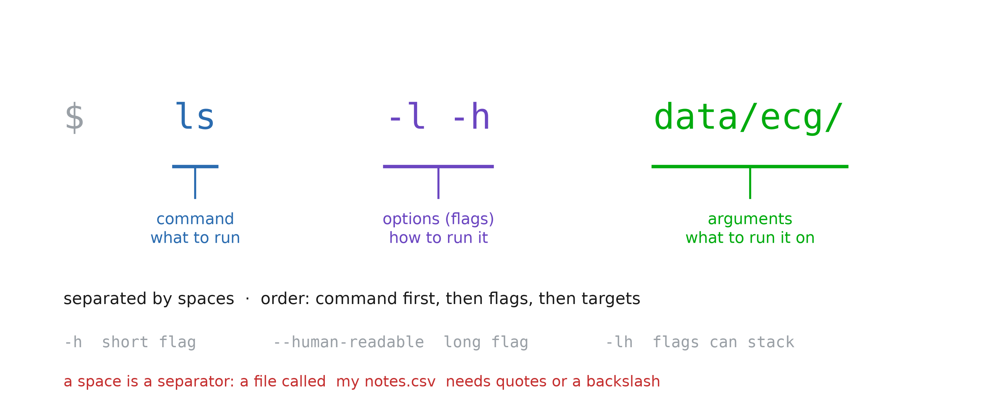
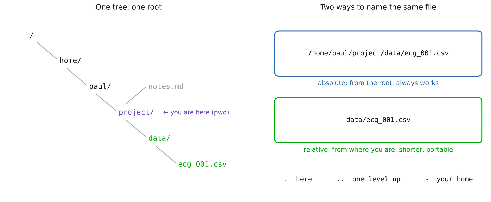
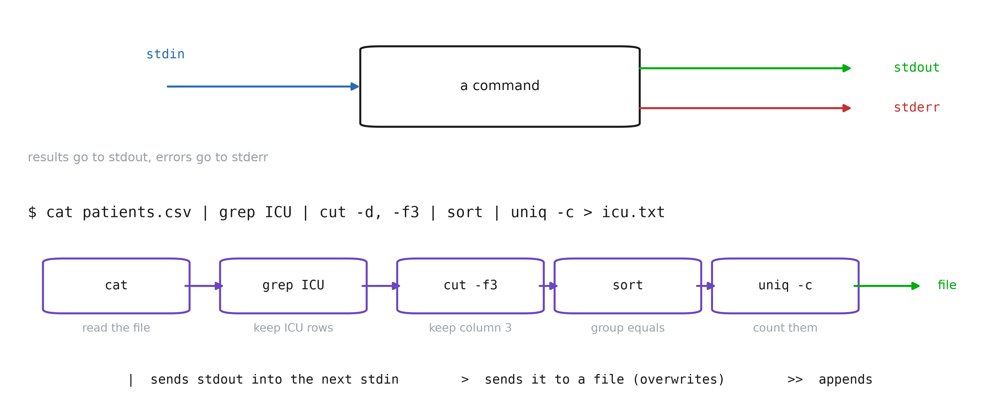
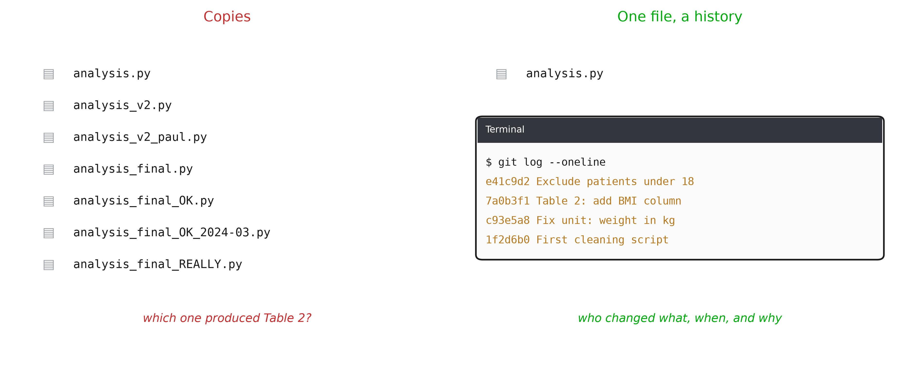
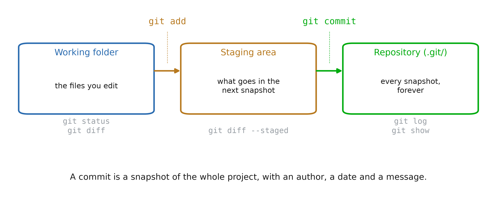
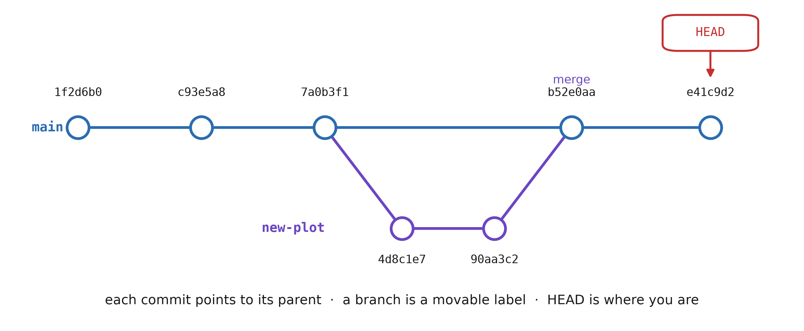
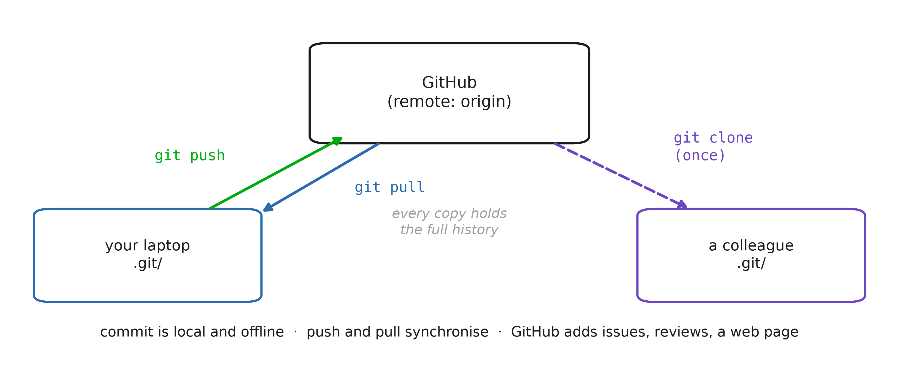

# 1. Why using a terminal?

## Most computers have no screen


::: notes
Rows of machines, and not one keyboard, mouse or monitor in the room. This is the NASA
Columbia supercomputer, but it is also every hospital server room, every cloud instance,
and every compute cluster you will send a job to.
Nobody walks in and clicks. You reach these machines over the network (`ssh`), and what
answers you is a text prompt. The graphical interface is the exception, available on your
laptop and almost nowhere else.
So the question is not whether the command line is pleasant. It is the only interface
these machines have, and that is where the data and the computing power live.
Ask the room: where do you think the imaging archive of a hospital actually sits?
:::

## Terminal, shell, program, kernel


::: notes
Four words students use as synonyms for a fortnight. Fixing this early saves a lot of
confusion later: "the terminal crashed" and "the shell is bash" and "ls is a program"
are three different statements.
Emphasise the closing line. Everything that follows (variables, loops, conditionals,
functions) is available *because* the shell is a language. The prompt is a REPL.
:::

## The anatomy of a command


::: notes
This is the grammar slide; every command in the notebook obeys it.
Two traps to name now, because both will bite in the exercises:
(1) a space separates arguments, so a filename with a space is two arguments unless
  it is quoted. Health data exports are full of `Patient Records 2024.csv`.
(2) flags are case sensitive and not universal: `-h` is "help" in some tools and
  "human readable" in others. There is no committee.
:::

# 2. Moving around, and moving data

## The file system is one tree


::: notes
Two ideas: there is a single root (no `C:` drive), and any file has two names
(absolute and relative) that point to the same thing.
Rule of thumb for their future scripts: absolute paths for data that lives somewhere
fixed, relative paths for anything inside the project, so the project can be moved,
shared, or run on the cluster untouched.
:::

## Five most usefull commands
```bash
# where am I
$ pwd
# go there  (cd .. to parent directory)
$ cd data/ecg
# list files
$ ls -lh
# create a folder
$ mkdir -p results/2026
# copy
$ cp a.csv backup_a.csv
# move / rename
$ mv a.csv new_a.csv
# delete
$ rm new_a.csv
```

::: notes
Type these live, slowly, in a scratch folder. Let them see the prompt change with
`cd`.
Give the `rm` warning its own beat. Then give them the habit that actually protects
them: run the dangerous thing as `ls` first (`ls *.tmp`), look at what matched, then
swap `ls` for `rm`. Never trust a glob you have not printed.
:::

## Text in, text out


::: notes
This is the intellectual core of the whole session, and the reason the tools are all
small. Each program does one job and speaks the same currency: lines of text. The
pipe is what makes them compose.
Build the example one stage at a time on screen, showing the intermediate output
after each `|`. Students remember the shape once they have watched it narrow.
Mention that this is exactly `pandas` chaining, ten years older and on files it never
has to load into memory.
:::

## More commands
| Command | Does |
|---|---|
| `cat` / `head` / `tail` | print a file, its first, its last lines |
| `wc -l` | count lines (rows in a CSV) |
| `grep 'ICU'` | keep the lines that match |
| `cut -d, -f2` | keep a column |
| `sort` / `uniq -c` | order, and count repeats |
| `find . -name '*.csv'` | list files matching a pattern, recursively |

::: notes
Do not try to teach these exhaustively (the notebook does that). Here just establish
that the toolbox is small, and that each one is a verb you can look up.
`sort | uniq -c` is the shell's `value_counts()`; say that out loud, it converts
anyone who already knows pandas.
:::

# 3. Version control

## Which file is the final one?



::: notes
Everyone in the room has a folder like the one on the left. It fails exactly when it
matters: a reviewer asks which version of the script produced Table 2, and nobody knows.
git replaces copies with one file and a history. Each change is recorded with who made
it, when, and a message that says why. In a regulated setting (a clinical study, a
CE-marked device) this traceability is not a nice-to-have: it is what an audit asks for.
git is a command-line program: everything from the first two sections applies.
:::

## Creating a snapshot



::: notes
The one mental model to get right. You edit files in the working folder as usual.
`git add` chooses which changes go into the next snapshot (the staging area). `git commit`
records that snapshot in the repository, the hidden `.git/` folder.
Why the middle step: you changed three files but only two belong to the same fix. Stage
those two, commit, then stage and commit the third with its own message.
`git status` is the command to type when lost: it says what is in each area, and
usually suggests the next command.
:::

## Daily loop

```bash
$ git init
$ git status
$ git diff
$ git add clean.py
$ git commit -m "Drop rows without age"
$ git log
```

::: notes
Live demo in a scratch folder: `git init`, create a file, `status`, `add`, `status`,
`commit`, edit, `diff`, commit again, `log`.
The first time, git asks who you are: `git config --global user.name "..."` and
`user.email`. Every commit carries that name.
A good message completes the sentence "this commit will...": "Drop rows without age",
not "update" or "fix". One logical change per commit.
:::

## History and branches



::: notes
Each commit has an identifier (a hash, shortened to 7 characters) and points to the
commit before it: the history is a chain.
A branch is just a name on a commit, moving forward as you commit. `git switch -c new-plot`
starts one: try an idea without touching `main`. If it works, `git merge new-plot` brings
it back; if not, delete the branch and `main` never knew.
`git switch` / `git checkout <hash>` moves HEAD, and the files in the folder change to
match that snapshot. Nothing is lost: every commit is still there.
:::

## Local and remote



::: notes
git works entirely on your machine: commit on a train, without network. A remote is
another copy of the repository, usually on GitHub (or GitLab, or the hospital's own
server). `git clone` makes your copy once; `git push` sends your new commits;
`git pull` fetches the others' commits and merges them into yours.
GitHub adds what git does not have: a web page for the project, issues to track bugs,
pull requests to review a change before it is merged. The course material lives there.
Two people editing the same lines produce a conflict: git marks both versions in the
file, you choose, then commit. It is a normal event, not an error.
:::

## Working with GitHub

```bash
$ git clone https://github.com/org/repo
$ cd repo

# ... edit, add, commit ...

# get the others' work
$ git pull
# publish yours
$ git push
```

::: notes
The everyday collaboration loop: pull before starting, push when done.
Authentication: GitHub no longer accepts your password on the command line. Use an SSH
key (`ssh-keygen`, then paste the public key in GitHub settings) or `gh auth login`.
This is a good exercise in its own right, and it reuses `ssh` from the first section.
For a new project: create the empty repository on GitHub, then `git remote add origin
<url>` and `git push -u origin main` from your existing folder.
:::

## What to ignore

```bash
# .gitignore
data/          # patient data
*.csv
.env           # passwords, API keys
.venv/         # re-created by uv sync
__pycache__/
```

::: notes
The health-data rule of this session. A commit is forever: deleting a file in a later
commit leaves it in the history, readable by anyone who clones. A patient file pushed to
a public GitHub repository is a data breach under GDPR, and must be reported.
`.gitignore` lists the patterns git must never track: data, secrets, generated files.
Write it first, before the first `git add .`.
The repository holds the code that reads the data, and a README saying where the data
lives and who may access it. The data itself stays on the secured server.
:::

# 4. Keeping the code readable: ruff

## One style, decided by a tool

```bash
$ uv venv
# create .venv
$ source .venv/bin/activate # unix
> .venv\Scripts\activate # windows

$ uv pip install ruff
# or: uv add --dev ruff

$ ruff --version
```

::: notes
`ruff` is a formatter *and* a linter for Python, from the same people as `uv`, so it
installs the same way and runs just as fast (a whole project in well under a second).
Two jobs, worth separating in their heads:
(1) the formatter rewrites the layout of your code: indentation, quotes, line breaks,
  spaces around operators. It never changes what the code does.
(2) the linter reads the code and reports mistakes: an unused import, a variable
  assigned and never read, a name that does not exist.
Why bother in a health-data project? Because a diff should show what you changed, not
who reformatted it. With a formatter, `git diff` contains only real changes, and code
review stops being an argument about spaces.
Note `uv add --dev ruff`: it is a development tool, not a dependency of the analysis, so
it belongs in the dev group of `pyproject.toml`.
If `ruff` is not on the path, run it through uv: `uv run ruff --version`.
:::

## Format, and check

```bash
# format one file
$ ruff format clean.py
# format everything, recursively
$ ruff format .

# report, but change nothing
$ ruff format --check .
# lint: find likely mistakes
$ ruff check .
# lint, and fix what is safe
$ ruff check --fix .
```

::: notes
Three commands to remember, and the difference between them is the whole point.
`ruff format <path>` rewrites the file in place and prints `1 file reformatted`. A
directory (`.` is the current one) means every `.py` file below it; files listed in
`.gitignore` are skipped, so `.venv/` is not touched.
`--check` is the read-only version: it lists the files that *would* change and exits with
a non-zero status if there are any. That is exactly what you put in a pull-request check
or a git hook: it fails the build instead of silently editing the author's code.
`ruff check` is the linter, a different command from `format`; `--fix` applies only the
corrections ruff considers safe.
Practical advice: run `ruff format .` once at the start of a project, commit that as
"format with ruff" on its own, and from then on every diff stays small. Doing it in the
middle of a feature branch produces a 400-line commit that hides the one line that
matters.
Demonstrate live on `clean.py` from the notebook: `ruff format --check clean.py`, then
`ruff format clean.py`, then `git diff`.
:::

## A lint check, safe and unsafe

```python
import os
# F401 unused import   -> safe fix
import pandas as pd

def mean_hr(path):
    df = pd.read_csv(path)
    n = len(df)
    # F841 unused variable -> unsafe fix
    return df["hr"].mean()

```

```bash

$ ruff check vitals.py
# Found 2 errors:
# * 1 fixable with `--fix`
# * 1 unsafe fix available with `--fix --unsafe-fixes`
```

::: notes
Two real findings on seven lines, and they are not equally safe to repair.
`F401 os imported but unused`: the import does nothing, so deleting the line cannot
change the result. Ruff marks that fix **safe**, and `ruff check --fix vitals.py`
removes it for you (and sorts the remaining imports, `I001`).
`F841 local variable n is assigned to but never used`: here ruff's fix is to drop the
`n =` and keep the call, `len(df)`. It marks it **unsafe**, because the right-hand side
might be doing something: `n = log_access(patient_id)` would still be called, but
`n = df.pop("hr")` changes `df`, and deleting the whole line would change the result.
Ruff refuses to guess. So `--fix` leaves it alone and tells you a `--unsafe-fixes` is
available; you only get it with `ruff check --fix --unsafe-fixes .`, and then you read
the diff before committing.
The rule for the room: `--fix` can run unattended, even in a hook. `--unsafe-fixes` is
something you run yourself, on a clean working tree, and check with `git diff`.
Also note F841 is often a real bug, not untidiness: the variable you computed and forgot
to return, or a typo where you assigned `mena` and used `mean`. Do not auto-delete the
evidence, read it.
:::
