## Data


::: notes
Before any figure there is a table: an export from the hospital information system, a
spreadsheet from a colleague, the results of a query. pandas is the library that reads it
and gives you one object, the DataFrame.
Vocabulary, which every error message uses. The DataFrame is the whole table. Each column
has a name and one type (`df.dtypes`); one column alone is a Series. Each row has a label,
the index, which by default is just its position.
The age column is read as `float64` and not as an integer because of the missing value:
`NaN` only exists for floats, so one empty cell makes the whole column float. That is the
first surprise of every real export.
`df.head()`, `df.shape`, `df.info()`: the three commands to run on any table you receive,
before anything else.
:::

## Table or array?


::: notes
A numpy array (Session 3) holds one type and positions. `a[:, 1]` is the second column, and
nothing in the array says what the second column was: you keep that in your head, or in a
comment, and one day you get it wrong.
A DataFrame keeps the names and allows one type per column, so text (`ward`, `outcome`) and
numbers live in the same table. `clean["age"]` cannot be the wrong column.
The rule for this course: pandas to load, clean and select; numpy inside, for the
computation; matplotlib at the end, for the figure. A column is a numpy array underneath,
so `ax.plot(df["age"], df["los_days"])` just works.
:::

## Loading a table

```python
import pandas as pd

df = pd.read_csv("../data/patients.csv")
df.head()
df.shape      # (240, 7)
df.dtypes     # one type per column
df.info()     # types and the number of values present
```

::: notes
`pd.read_csv` is one line for what took a `csv.DictReader` loop, a list of dicts and a
manual conversion of every field. It also reads Excel (`read_excel`), JSON, SQL and others,
with the same shape of call.
Useful arguments when the export does not cooperate: `sep=";"` (the French Excel default),
`decimal=","`, `na_values=["", "NA", "NR"]`, `parse_dates=["admission"]`,
`encoding="latin-1"`.
`df.info()` is the one that tells you how many values are actually present per column, so
how many are missing.
:::

## Missing values and types

```python
df.isna().sum()                  # how many NaN per column

clean = df.dropna()              # keep only the complete rows
len(df), len(clean)              # 240, 232

clean["age"] = clean["age"].astype("int64")
clean["ward"] = clean["ward"].astype("category")
clean["admission"] = pd.to_datetime(clean["admission"])
```

::: notes
`isna()` gives a table of True/False, and `.sum()` counts the True per column: the missing
value report of the export, in one line.
`dropna()` removes every row with at least one missing value. It is the simplest choice,
not always the right one: here it costs 8 patients out of 240. `dropna(subset=["age"])`
drops only on the column that matters, and `fillna(value)` replaces instead of dropping.
Whatever you choose, say it in the methods section.
Once the NaN are gone, `astype("int64")` gives back a real integer age. `"category"` is for
a column with few distinct values (the ward, the outcome): less memory, and it says that
these are groups. `pd.to_datetime` turns the admission text into real dates, which can be
subtracted and sorted.
:::

## Selecting

```python
clean["age"]                     # one column, a Series
clean["age"].mean()              # 50.9
clean["ward"].value_counts()     # how many patients per ward

summary = clean[["patient_id", "age"]]  # a smaller DataFrame

type(clean["age"])               # Series
type(clean[["age"]])             # DataFrame, one column
```

::: notes
One name in the brackets gives a Series, which carries the usual statistics as methods:
`mean`, `median`, `std`, `min`, `max`, `describe`.
`value_counts()` is the one you will use constantly on the categorical columns: the number
of patients per ward, per outcome, per sex, sorted, in one call.
A list of names in the brackets gives a DataFrame with those columns, in that order. Hence
the double brackets: the outer ones are the selection, the inner ones are the list.
Selecting rows instead of columns is a condition: `clean[clean["ward"] == "ICU"]`, exactly
the boolean masks of Session 3, applied to a table.
:::

## A new column with .apply

```python
def stay_length(days):
    if days < 3:
        return "short"
    if days > 10:
        return "long"
    return "medium"

summary["stay"] = summary["los_days"].apply(stay_length)
```

::: notes
add `summary["age_group"] = summary["age"].apply(lambda a: "minor" if a < 18 else "adult")`?

`.apply(f)` calls `f` on every value of the column and returns a new column of results. The
function is an ordinary Python function (Session 2), so any rule you can write, you can
apply: a clinical threshold, a recoding, a parsing of a free text field.
Assigning to `summary["stay"]` with a name that does not exist yet creates the column.
For arithmetic, do not use `apply`: `clean["weight"] / clean["height"] ** 2` works on whole
columns at once, and is much faster because numpy does the loop. Keep `apply` for what
cannot be written as a formula.
:::

## Saving a table

```python
summary.to_csv("patients_summary.csv", index=False)

back = pd.read_csv("patients_summary.csv")
back.shape        # (232, 6)
```

::: notes
`to_csv` writes the table back to disk, and `index=False` keeps the row labels out of the
file. Without it you get a nameless first column of 0, 1, 2, which the next reader (often
you, next month) has to clean up again.
Other formats, same call: `to_excel` when a colleague asks for it, `to_parquet` for a large
table that stays inside the project (smaller and faster, and it keeps the types).
Never save over the raw export. The raw file stays untouched, the script rebuilds everything
else: that is what makes the analysis reproducible.
:::

## Full workflow


::: notes
This is the shape of almost every analysis script: load, clean, select, compute, save, and
then plot.
Every step returns a new table instead of changing the old one, so the variable names
(`df`, `clean`, `summary`) record the state of the data at each step, and re-running a cell
cannot corrupt what came before.
The rest of this session is the last arrow, the figures, with matplotlib. The columns you
just selected are what you are about to plot.
:::

## Understanding with a plot

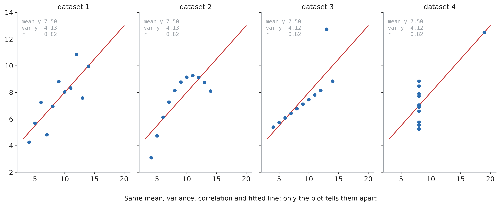

::: notes
Anscombe's quartet (1973). Four datasets of 11 points: same mean, same variance, same
correlation, same regression line, to two decimals. A table of summary statistics says they
are identical.
The plots say: a noisy linear relation, a curve, a perfect line with one outlier, and no
relation at all except one extreme point.
The habit to build: plot the raw data before any statistic. In clinical data the plot is
where you find the impossible ages, the unit changes (kg vs lb), the duplicated rows and
the device that was unplugged.
:::

## Anatomy of a figure

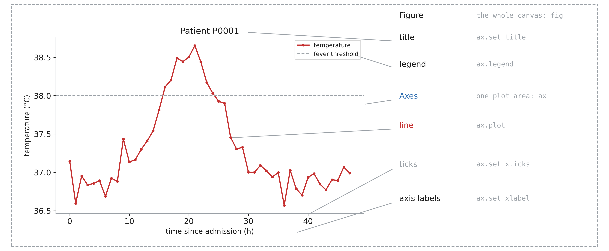

::: notes
Matplotlib vocabulary, which every error message and every Stack Overflow answer uses.
The Figure is the canvas: the file you save. An Axes (with an e, plural Axes) is one plot
area with its own coordinates: a figure can hold several. Everything else (line, title,
labels, ticks, legend) belongs to one Axes, and is set by a method of that Axes.
Do not confuse Axes (the plot area) with axis (the x or y ruler of an Axes).
:::

## First figure

```python
import matplotlib.pyplot as plt

fig, ax = plt.subplots()
ax.plot(t, temp, label="temperature")
ax.axhline(38, ls="--", label="fever")
ax.set_xlabel("time (h)")
ax.set_ylabel("temperature (°C)")
ax.set_title("Patient P0001")
ax.legend()
fig.savefig("temp.png", dpi=200)
```

::: notes
The pattern of every figure in this course: create the figure and its axes, draw on the
axes, label the axes, save the figure.
`plt.subplots()` returns two things, unpacked into `fig` and `ax` (tuple unpacking, from
Session 1).
You will also see the short style `plt.plot(...)`, `plt.xlabel(...)`: it draws on "the
current axes". It is fine for a quick look, but as soon as there are two plots it becomes
ambiguous. Use `fig, ax` everywhere and you never have to wonder.
In a notebook the figure is displayed at the end of the cell; in a script, call
`plt.show()` or just save it.
:::

## Several plots in one figure

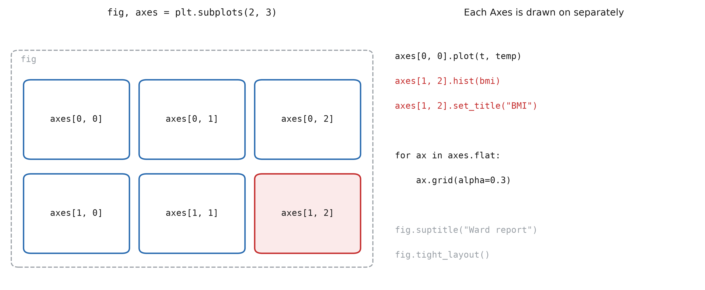

::: notes
`plt.subplots(2, 3)` returns a numpy array of Axes, shape `(2, 3)`, indexed exactly like
the arrays of Session 1: `axes[1, 2]` is the bottom right one.
With a single row or column the array is 1D: `axes[0]`, `axes[1]`.
`axes.flat` iterates over all of them, to apply the same setting everywhere.
`sharex=True` gives all plots the same x axis (essential for vitals over time).
`fig.tight_layout()` fixes overlapping labels: call it just before saving.
:::

## Which plot?

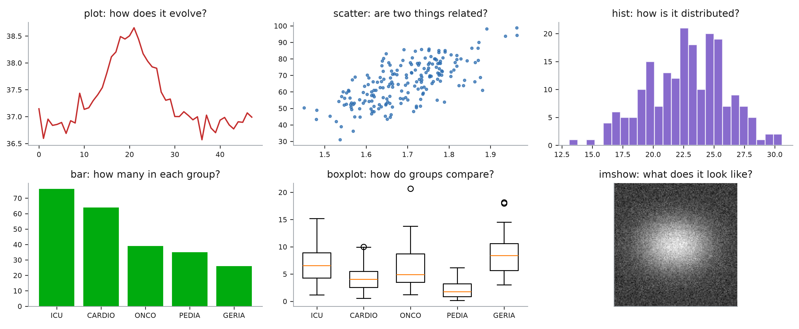

::: notes
Choose the plot from the question, not from the data.
How does a value evolve: `plot`, a line, x is time. Are two measurements related:
`scatter`, one point per patient. How is one measurement distributed: `hist`. How many
patients in each group: `bar`. How does a measurement compare between groups: `boxplot`.
What does a 2D array look like: `imshow`.
Every one of them is a method of `ax`, and every one takes numpy arrays.
:::

## Line plots: evolution

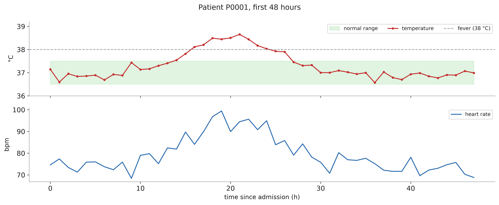

::: notes
Lines are for ordered x values: time, dose, age. If the x values are not ordered (patients),
a line between them means nothing: use a scatter.
Two measurements with different units get two Axes sharing x, not one Axes with two
scales mixed.
`marker` shows where the actual measurements are: with one value per hour, the line between
two points is an interpolation, not data.
`ax.axhline(38)` and `ax.fill_between(t, 36.5, 37.5, alpha=0.15)` put the clinical reference (threshold, normal range) on the
plot, so the reader does not have to remember it.
:::

## Scatter plots: relations

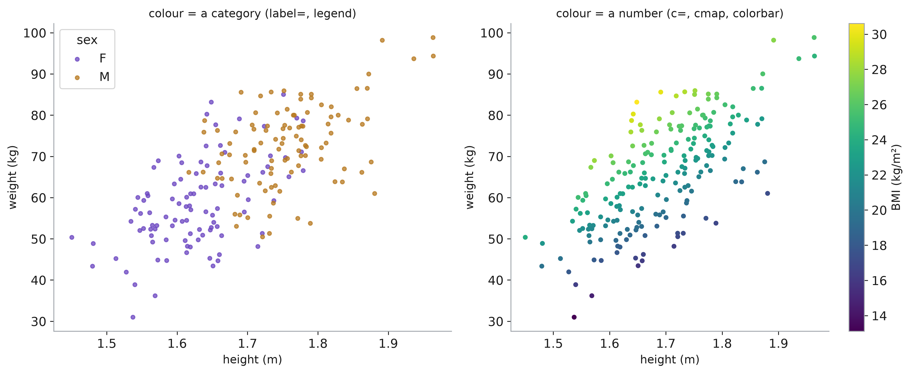

::: notes
One point per patient, two measurements as coordinates.
A third variable can go in the colour. A category: one `scatter` call per group, each with
a `label`, and `ax.legend()`. A number: `c=values` with a colour map, and `fig.colorbar` to
read it back.
With thousands of points, reduce `s` (size) and add `alpha` (transparency) so that dense
regions become visible instead of a solid blob.
:::

## Histograms: distributions

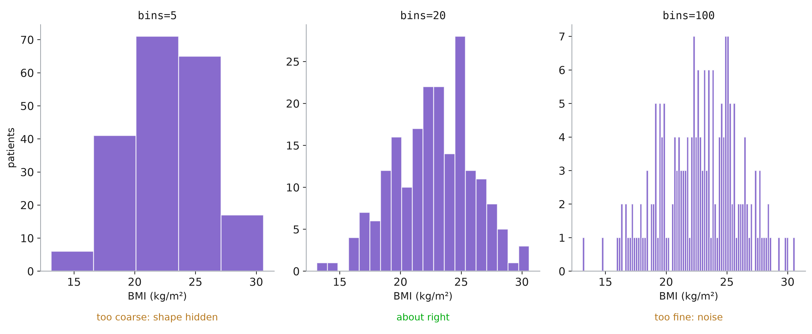

::: notes
A histogram counts values in bins. The number of bins changes the story: too few hide the
shape, too many show only noise. Try several, and say which one you kept.
`bins` also accepts the edges themselves, e.g. `bins=np.arange(10, 45, 1)`: one bar per BMI
unit, comparable between figures.
`density=True` divides by the total, to compare groups of different sizes.
:::

## Bars and boxes: groups

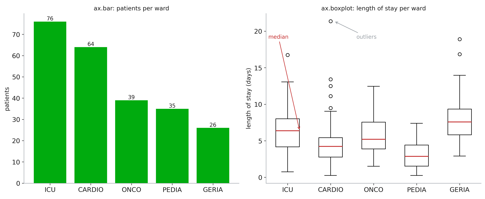

::: notes
A bar is for a count or a total per group: its height is the information, so the y axis
must start at 0.
To compare a measurement between groups, a bar of the mean hides everything; a boxplot
shows the median (line), the middle 50 % (box), the range (whiskers) and the outliers
(circles).
Length of stay is the classic skewed variable: most stays are short, a few are very long.
The mean would be pulled up by them; the boxplot shows it at once.
:::

## Images: 2D arrays

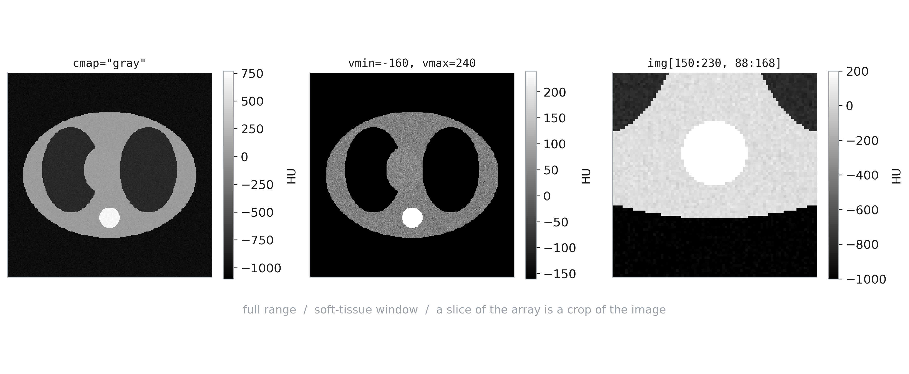

::: notes
`imshow` turns each value of a 2D array into a pixel, through a colour map. A CT slice is
just a numpy array of Hounsfield units: -1000 is air, 0 water, about 40 soft tissue, several
hundred for bone.
`vmin` and `vmax` choose which values span the colour map: this is the "window" radiologists
change all day. The same array shows lungs or soft tissue depending on the window.
Slicing the array crops the image: everything from Session 1 applies to images.
Always add a colorbar with the unit: without it, the grey levels mean nothing.
:::

## Colour maps

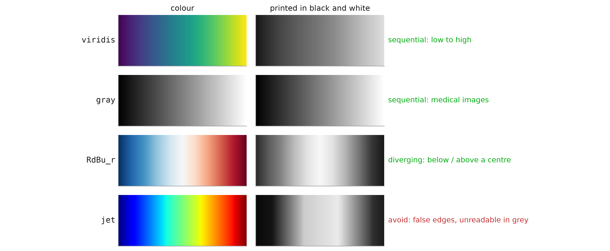

::: notes
A colour map encodes a number; the eye must read it as a number.
Sequential maps (viridis, the default, or gray) go from dark to light: brightness increases
with the value, even printed in black and white, and for colour-blind readers (about 1 man
in 12).
Diverging maps (RdBu) are for data with a meaningful centre: change from baseline,
correlation. Set `vmin=-v, vmax=v` so that the centre is white.
jet (rainbow) creates bands that are not in the data, and its brightness goes up and down:
it is still in many medical software packages, and it should not be in your figures.
:::

## Colour maps

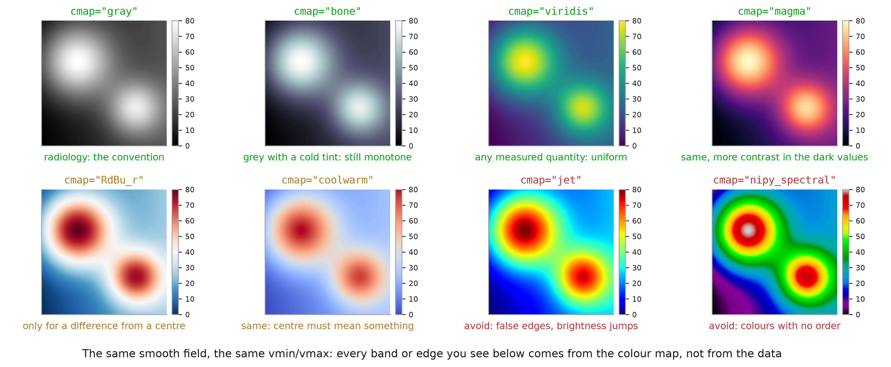

::: notes
One smooth field (think a perfusion map, mL/100 g/min), one window
(`vmin=0, vmax=80`): everything that changes between these eight panels is the colour
map, and so is everything the reader sees. The data has no edge anywhere; every ring and
every band below was added by the colour map.
gray is the convention for CT, MRI and X-ray: radiologists read grey levels, and a
colourful slice looks wrong to them. bone is the same idea with a cold tint.
viridis and magma are the default choices for a measured quantity (perfusion, dose,
activation, a correlation matrix): brightness increases with the value, so they survive
printing in black and white and colour blindness.
RdBu_r and coolwarm are for a difference: post minus pre, patient minus atlas, a
correlation. They need `vmin=-v, vmax=v` so the white is exactly 0. On raw data, where
no value is special, they invent a centre that does not exist, which is what you see here.
jet and nipy_spectral put bands and bright spots where the data is smooth. They are still
the default in a lot of medical software; change them.
Rule of thumb: one quantity going up, sequential (gray, viridis); a signed difference,
diverging centred on 0; categories (segmentation labels), a qualitative map such as
tab10 with `imshow` and no colorbar.
:::

## Saving

```python
fig.tight_layout()
fig.savefig("fig1.png", dpi=300)
fig.savefig("fig1.pdf")
fig.savefig("fig1.svg")

plt.close(fig)    # in loops
```

::: notes
The format is chosen by the extension. PNG is an image: choose a `dpi` high enough for the
final size (300 for print). PDF and SVG are vector formats: lines and text stay sharp at
any zoom, and journals ask for them.
Save from code, never with a screenshot: the figure is then reproducible, and regenerating
it after a data correction is one command.
In a loop that makes a figure per patient, `plt.close(fig)` frees the memory; otherwise
matplotlib keeps them all and warns after 20.
:::
